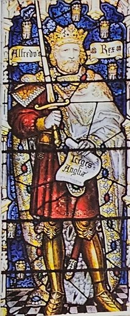
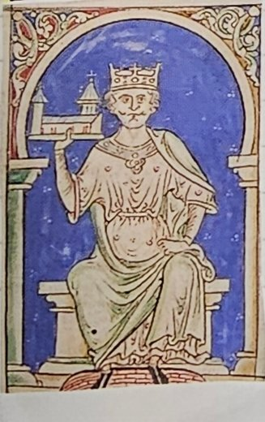
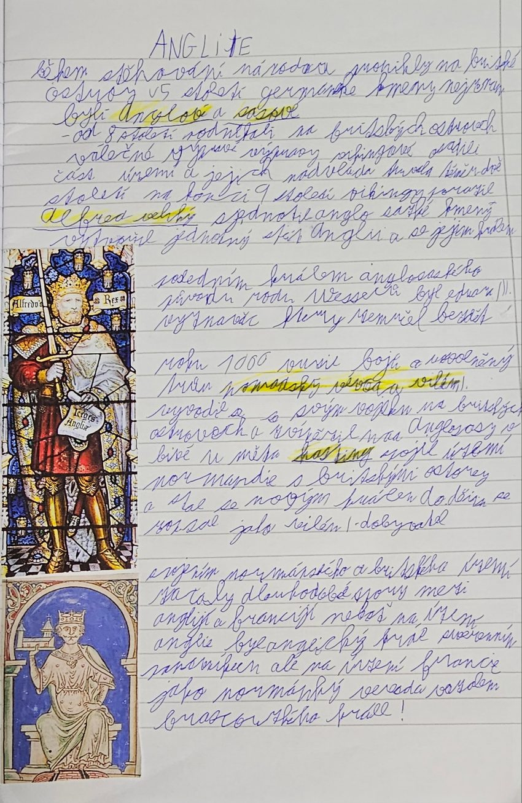

# Anglie

> **Ve zkratce:** Na Britské ostrovy přišli v 5. století Anglové a Sasové. Alfréd Veliký porazil Vikingy a sjednotil Anglii. Roku 1066 vyhrál normandský vévoda Vilém I. Dobyvatel bitvu u Hastingsu a stal se anglickým králem.

## Anglosasové a Vikingové

Během **stěhování národů** pronikly v **5. století** na **Britské ostrovy** **germánské kmeny**. Nejznámější byli <mark>Anglové</mark> a <mark>Sasové</mark>, proto se jim říká **Anglosasové**. Podle Anglů dostala jméno celá země, **Anglie**.

Od **8. století** podnikali na Britské ostrovy **válečné výpravy Vikingové**, mořeplavci ze Severu. Část území **osídlili** a jejich nadvláda trvala **téměř dvě století**.

Na konci **9. století** Vikingy porazil <mark>Alfréd Veliký</mark>. **Sjednotil anglosaské kmeny**, vytvořil **jednotný stát Anglii** a stal se jejím **králem**.

**Proč je to důležité:** dokud byly kmeny rozdělené, Vikingové je snadno porazili jeden po druhém. Spojené pod jedním králem se dokázaly ubránit. Proto má Alfréd přídomek *Veliký*.

## Rok 1066: Vilém Dobyvatel

Posledním králem **anglosaského původu** z rodu **Wessexů** byl **Eduard Vyznavač**. Zemřel **bez dětí**, takže nebylo jasné, kdo po něm zdědí trůn.

Roku **1066** proto vypukly **boje o uvolněný trůn**. <mark>Normandský vévoda Vilém I.</mark> se svým vojskem připlul na Britské ostrovy a porazil Anglosasy v bitvě u <mark>Hastingsu</mark>. Stal se novým anglickým králem a spojil **Normandii** (kraj na severu Francie) s Anglií. Do dějin se zapsal jako **Vilém I. Dobyvatel**.

**Proč je to důležité:** v Anglii začali vládnout **Normané** a vznikl spor, který trval velmi dlouho (viz níže). Rok 1066 je jeden z nejznámějších letopočtů anglických dějin.

## Proč se Anglie a Francie přely

Po spojení Normandie s Anglií nastaly **dlouhodobé spory mezi Anglií a Francií**. Anglický král totiž měl dvě role:

- **v Anglii** byl **svrchovaným panovníkem**, nad ním nebyl nikdo,
- **ve Francii** byl jako **normandský vévoda** **vazalem francouzského krále**.

**Vazal** je ten, kdo dostal od svého pána půdu a musí mu za ni sloužit a poslouchat ho. Anglický král tedy musel poslouchat francouzského krále. To se mu nelíbilo, a proto spolu oba státy dlouho bojovaly.

## Zapamatuj si

**5. století Anglové a Sasové → od 8. století Vikingové → konec 9. století Alfréd Veliký porazil Vikingy a sjednotil Anglii → Eduard Vyznavač zemřel bez dětí → 1066 Vilém I. Dobyvatel vyhrál u Hastingsu → anglický král = vazal francouzského krále → spory Anglie a Francie.**

## Paměťový obraz

- **Andělé a saská dýka:** *Anglové* a *Sasové* připlouvají v 5. století.
- **Vikingská loď s dračí hlavou:** Vikingové od 8. století, Alfréd Veliký je odráží.
- **Zpovědník u prázdné kolébky:** Eduard Vyznavač zemřel bez dětí.
- **Rytíři na pláži u Hastingsu 1066:** Vilém Dobyvatel přeplouvá z Normandie.
- **Král se dvěma korunami, jednou se klaní:** v Anglii vládne, ve Francii poslouchá jako vazal.

### Ověření proti zápiskům

Sešit píše **Eduard III. Vyznavač**. Obvykle se mu říká jen **Eduard Vyznavač**, bez čísla. *Eduard III.* je jiný, mnohem pozdější anglický král, tak ať se to neplete. Alfréd Veliký vládl Anglosasům, část země ale Vikingům zůstala. Celou Anglii pod jednoho krále spojili až jeho nástupci.

## Zápis ze sešitu

Fotka stránky sešitu

