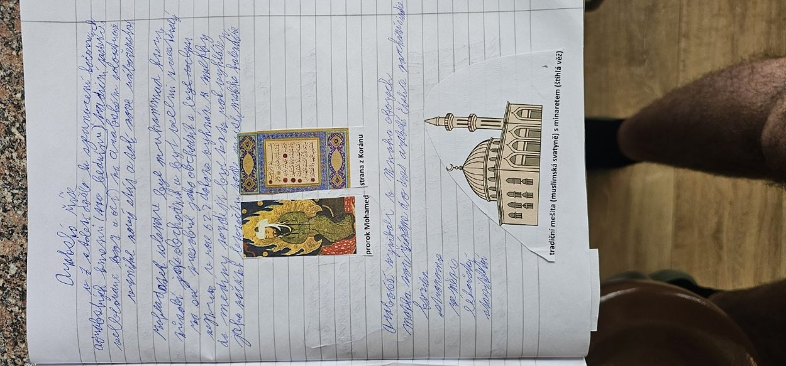

# Arabská říše a islám

## Arabský poloostrov a Mohamed

Arabové žili na Arabském poloostrově, kde byly obchodní osady, města i kočovné kmeny. Významným střediskem byla **Mekka**. V **7. století** zde vznikl **islám**, monoteistické náboženství, jehož ústřední prorockou osobností je **Mohamed (Muhammad)**. Muslimové věří v jediného Boha (arabsky **Alláh**) a jejich posvátnou knihou je **Korán**.

Roku **622** Mohamed odešel z Mekky do **Medíny**. Této události se říká **hidžra** a od jejího roku se odvozuje muslimský letopočet. Mohamed zemřel roku **632**. Po něm vedli muslimskou obec **chalífové**.

## Arabská expanze

V 7. a 8. století Arabové a další muslimská vojska ovládli rozsáhlá území Blízkého východu, severní Afriky i části Pyrenejského poloostrova. **Roku 732** franský vojevůdce **Karel Martel** porazil muslimské vojsko v bitvě u **Tours/Poitiers**. Neznamenalo to konec všech muslimských výbojů, ale šlo o významnou franskou výhru.

## Kultura a vzdělanost

Arabský a širší islámský svět rozvíjel **matematiku, lékařství, astronomii, zeměpis a obchod**. Významné bylo předávání a rozvíjení starověkých znalostí. Muslimové se modlí v **mešitě**; **minaret** je věž, z níž se tradičně svolává k modlitbě.

## Harún ar-Rašíd

**Harún ar-Rašíd** byl abbásovský chalífa (vládl **786–809**). Udržoval diplomatické styky s **Karlem Velikým** a poslal mu slona jménem **Abú al-Abbás**. Vystupuje také v příbězích spojených se sbírkou **Tisíc a jedna noc**, kterou rámcově vypráví **Šeherezáda**.

### Zapamatuj si

**Mohamed → islám → Korán → 622 (hidžra) → chalífové → arabská expanze.**

### Ověření proti zápiskům

Rok 622 **není** datum okamžitého vzniku islámu; je to rok hidžry. Náboženství se rozvíjelo již dříve. Datum 732 je spojeno s bitvou u Tours/Poitiers, nikoli se zastavením všech dalších muslimských vojenských akcí v Evropě.
