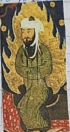
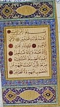
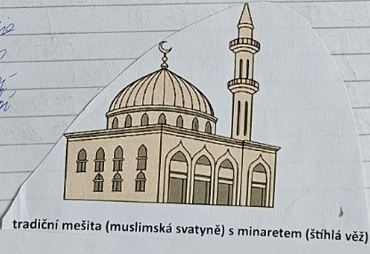
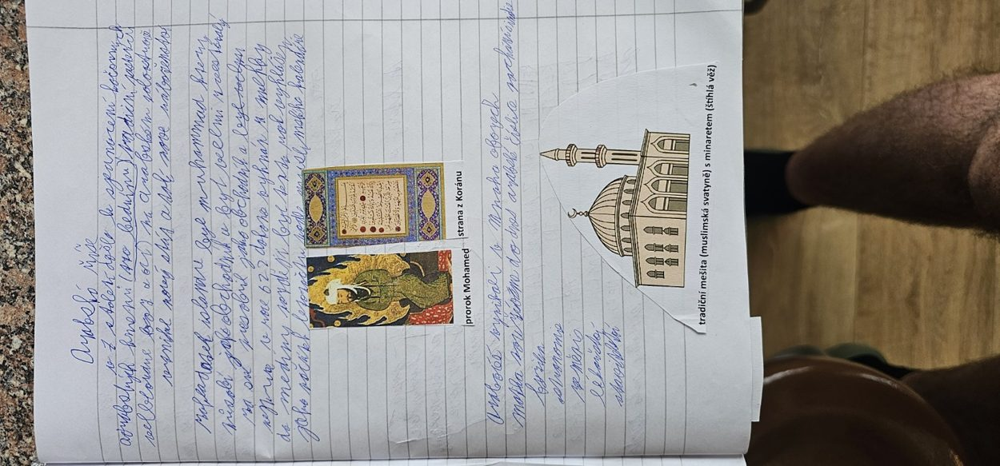
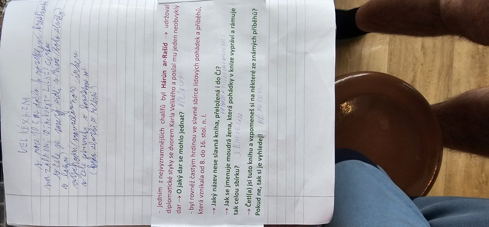
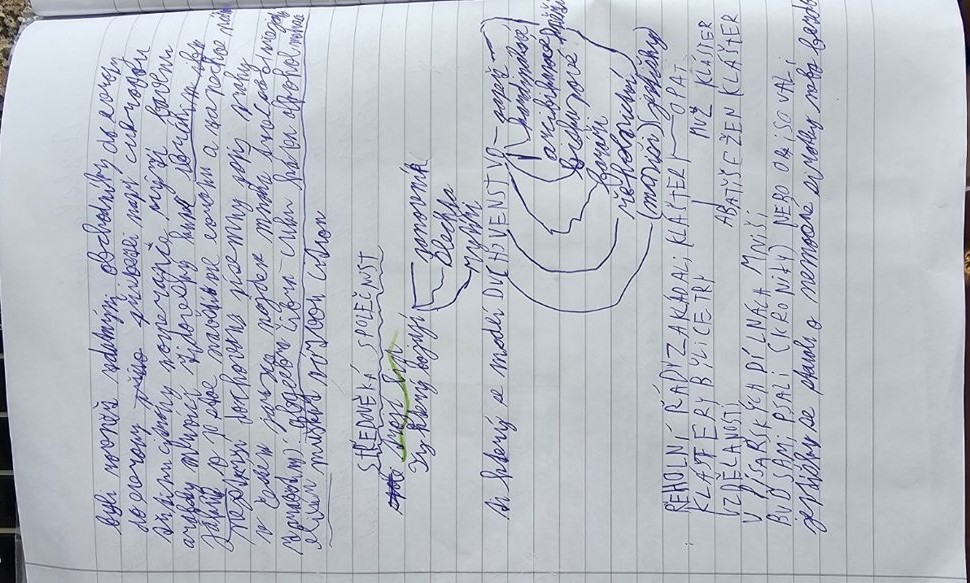

# Arabská říše a islám

> **Ve zkratce:** V 7. století se sjednotily kočovné arabské kmeny a vzniklo nové náboženství, islám. Arabové vynikali v matematice a dalších vědách, byli zdatní obchodníci a dali nám arabské číslice i mnoho slov.

## Vznik arabské říše a islámu

V **7. století** došlo ke **sjednocení kočovných arabských kmenů**, tzv. <mark>beduínů</mark>. Beduíni byli **tradiční pastevci velbloudů, koz a ovcí** a putovali se stády pouští. Na **Arabském poloostrově** tak vznikl **nový stát** a také **nové náboženství**, **islám**.

**Zakladatelem islámu** byl **Muhammad (Mohamed)**. Působil jako **obchodník** a hodně cestoval. V roce **622** musel odejít z **Mekky** do **Medíny**. Později byl tento rok vyhlášen jako **počátek letopočtu** podle **muslimského kalendáře**: pro muslimy je to „rok 1“.

Posvátnou knihou islámu je **Korán** (obrázek v sešitě).

Muslimskou svatyní je **mešita**. Štíhlá věž u ní se jmenuje **minaret**.

## Věda a vzdělanost

Arabové **vynikali v mnoha oborech**:

- **matematika**: dodnes používáme **arabské číslice**, které Arabové převzali z **Indie**,
- **fyzika**,
- **astronomie**,
- **zeměpis**,
- **lékařství**,
- **stavitelství**.

**Proč je to důležité:** s arabskými číslicemi se počítá mnohem snáz než s římskými (zkus vynásobit XLVII krát XIII). Proto se jimi počítá dodnes po celém světě.

## Obchod a arabská slova

Arabové byli také **zdatnými obchodníky**. Do Evropy přivezli například **cukrovou třtinu**, **citrony**, **pomeranče**, **rýži** a **bavlnu**.

Arabsky mluvící židovský kupec <mark>Ibráhím ibn Jákúb</mark> v **10. století** navštívil Evropu a zanechal nám **nejstarší dochovaný písemný popis Prahy**.

**Proč je to důležité:** je to nejstarší zpráva o Praze, kterou máme. Díky němu víme, jak Praha v 10. století vypadala.

V češtině najdeme mnoho **slov arabského původu**: <mark>algebra, cifra (číslo), cukr, káva, alkohol, matrace, elixír, citron</mark>.

## Harún ar-Rašíd

Jedním z nejvýznamnějších **chalífů** (vládců arabské říše) byl **Harún ar-Rašíd**. Udržoval **diplomatické styky** se dvorem **Karla Velikého** a poslal mu neobvyklý dar: **bílého slona**.

Harún je také častým hrdinou slavné sbírky pohádek a příběhů **Tisíc a jedna noc** (*Pohádky tisíce a jedné noci*), která vznikala od 8. do 16. století. Pohádky v knize vypráví moudrá **Šeherezáda**.

Souvislost: roku **732** porazil Araby franský majordomus **Karel Martel** u **Poitiers** (téma Franská říše).

## Zapamatuj si

**7. století: beduíni se sjednotili → nový stát a islám → Muhammad, obchodník → 622 z Mekky do Medíny = začátek muslimského letopočtu → Korán, mešita s minaretem → arabské číslice z Indie, fyzika, astronomie, zeměpis, lékařství, stavitelství → obchod (cukrová třtina, citrony, pomeranče, rýže, bavlna) → Ibráhím ibn Jákúb: nejstarší popis Prahy → Harún ar-Rašíd: bílý slon pro Karla Velikého, Šeherezáda.**

## Paměťový obraz

- **Karavana velbloudů:** beduíni se sjednotí, Muhammad obchodník jede z Mekky do Medíny roku 622.
- **Kalkulačka s nulou:** arabské číslice z Indie.
- **Loď plná citronů a cukru:** arabští obchodníci, slova cukr, káva, citron.
- **Kupec s pergamenem na Pražském hradě:** Ibráhím ibn Jákúb popisuje Prahu.
- **Bílý slon u Karla Velikého:** Harún ar-Rašíd, Tisíc a jedna noc, Šeherezáda.

### Ověření proti zápiskům

Rok 622 **není** rok vzniku islámu. Je to rok odchodu Muhammada z Mekky do Medíny (tzv. **hidžra**). Muhammad kázal už předtím.

## Zápis ze sešitu

Fotky stránek sešitu

