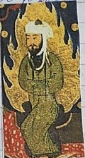
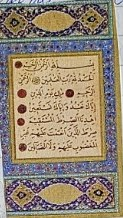
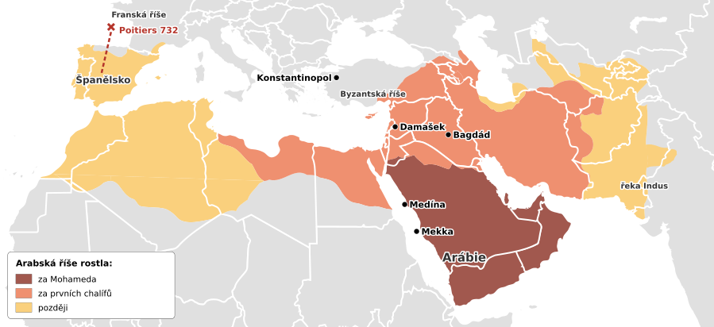
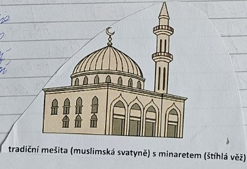

# Arabská říše a islám

> **Ve zkratce:** V 7. století vzniklo v Arábii nové náboženství, islám. Arabové se za sto let rozšířili od Indu po Španělsko a jejich učenci rozvíjeli matematiku, lékařství i astronomii.

## Arabský poloostrov a Mohamed

**Arabský poloostrov** je z velké části poušť. Část Arabů žila jako **kočovníci** (beduíni): putovali s velbloudy a stády od jedné studny ke druhé. Další žili v **obchodních městech**, kudy procházely **karavany** s kořením, látkami a kadidlem. Nejdůležitějším městem byla **Mekka**. Stála v ní svatyně **Kaaba**, kam se lidé chodili klanět mnoha bohům, a z poutníků měli místní obchodníci velké zisky.

V **7. století** začal v Mekce kázat obchodník **Mohamed (Muhammad)**. Podle muslimů mu Bůh skrze anděla **Gabriela** sděloval svá slova. Mohamed učil, že existuje **jen jeden Bůh** (arabsky **Alláh**). Taková víra v jednoho Boha se nazývá **monoteismus**, stejně jako u židů a křesťanů. Nové náboženství se jmenuje **islám** (znamená „odevzdání se Bohu“) a jeho vyznavači jsou **muslimové**. Slova, která Mohamed hlásal, byla sepsána do posvátné knihy **Koránu**.

Bohatým Mekkáncům se Mohamedovo kázání nelíbilo: kdyby lidé přestali uctívat mnoho bohů, přestali by k Kaabě chodit poutníci a obchodníci by přišli o peníze. Mohameda proto pronásledovali. Roku **622** odešel se svými přívrženci z Mekky do **Medíny**. Tomuto odchodu se říká **hidžra** a rokem 622 začíná **muslimský letopočet** (u muslimů je to „rok 1“). V Medíně Mohamed získal mnoho stoupenců, roku **630** se do Mekky vrátil jako vítěz a z Kaaby dal odstranit sochy bohů. Zemřel roku **632**. Po něm vedli muslimy **chalífové**. Slovo **chalífa** znamená „nástupce“: chalífa byl zároveň náboženský vůdce i vládce říše.

## Pět pilířů islámu

Každý muslim má plnit pět hlavních povinností:

1. **vyznání víry**: „Není boha kromě Boha a Mohamed je jeho prorok“,
2. **modlitba pětkrát denně**, obrácen směrem k Mekce,
3. **almužna**: pomoc chudým,
4. **půst v měsíci ramadánu**: od východu do západu slunce se nejí ani nepije,
5. **pouť do Mekky** aspoň jednou za život, pokud na to má zdraví a peníze.

## Arabská expanze

Mapa: [Wikimedia Commons](https://commons.wikimedia.org/wiki/File:Map_of_expansion_of_Caliphate.svg) – DieBuche, volné dílo; doplněny české popisky.

Za necelých sto let po Mohamedově smrti ovládli Arabové obrovské území **od řeky Indus po Španělsko**. Rozšířili se tak rychle ze dvou důvodů: islám spojil dříve znesvářené arabské kmeny, a sousední **Byzantská** a **Perská říše** byly vyčerpané dlouhými válkami mezi sebou.

- Hlavním městem se nejdřív stal **Damašek** (dnešní Sýrie).
- Roku **711** se Arabové přeplavili z Afriky do **Španělska**. Vedl je vojevůdce **Tárik** a podle něj se skála u průlivu jmenuje **Gibraltar** (z arabského *Džabal Tárik* = „Tárikova hora“). Ve Španělsku pak muslimové vládli přes 700 let, až do roku **1492**.
- **Roku 732** porazil franský vojevůdce **Karel Martel** muslimské vojsko v bitvě u **Tours/Poitiers** a zastavil jejich postup do Francie. Přezdívalo se mu **„Kladivo“**.
- Později se hlavním městem stal nově založený **Bagdád** (dnešní Irák).

## Kultura a vzdělanost

Muslimové se modlí v **mešitě**. **Minaret** je vysoká věž u mešity, z níž **muezzin** svolává věřící k modlitbě. V mešitách nejsou obrazy lidí ani zvířat, protože islám zakazuje uctívat obrazy. Místo nich se zdobí **ornamenty** z rostlin a geometrických tvarů (**arabesky**) a krásně psaným písmem (**kaligrafií**).

Arabští učenci rozvíjeli **matematiku, lékařství, astronomii a zeměpis**. Řadu věcí z jejich světa používáme dodnes:

- **arabské číslice** 0–9: Arabové je převzali z **Indie** a přinesli do Evropy, i s **nulou**. Předtím se v Evropě počítalo **římskými číslicemi**, se kterými se špatně násobí a dělí.
- **algebra**: je to arabské slovo; z arabštiny pochází i **alkohol, káva, cukr** nebo **magazín** (původně „sklad“).
- **zachování antického vědění**: v Bagdádu učenci **překládali řecké knihy** (například Aristotela) do arabštiny. Evropa mnoho z nich znovu poznala až z těchto překladů.
- **lékařství**: lékař **Avicenna (Ibn Sína)** napsal knihu o medicíně, podle které se učili lékaři i v Evropě ještě stovky let.

## Harún ar-Rašíd

**Harún ar-Rašíd** byl chalífa, který vládl z **Bagdádu** v letech **786–809**. V té době byl Bagdád jedním z největších a nejbohatších měst světa. Harún udržoval přátelské styky s **Karlem Velikým** a poslal mu darem **slona** jménem **Abú al-Abbás**. Takové zvíře v západní Evropě nikdo neviděl.

Harún vystupuje i v pohádkách ze sbírky **Tisíc a jedna noc**. Vypráví je **Šeherezáda**: krutý král se chystal ji popravit, a tak mu každou noc vyprávěla příběh, který přerušila v nejnapínavějším místě. Král chtěl slyšet pokračování, a proto ji nechal žít, až se nakonec rozhodl ji ušetřit. K této sbírce patří i příběhy o **Sindibádovi námořníkovi**, **Aladinovi** a **Ali Babovi**.

## Zapamatuj si

**Mohamed hlásal víru v jednoho Boha → islám, posvátná kniha Korán → 622 hidžra (útěk z Mekky do Medíny) → chalífové → říše od Indu po Španělsko → 732 Poitiers. Arabové předali Evropě číslice s nulou a antické vědění.**

## Paměťový obraz

- **Karavana v poušti:** Mohamed, Mekka, islám, Korán, rok 622, Medína.
- **Slon u Karla Velikého:** Harún ar-Rašíd, diplomacie, Tisíc a jedna noc.
- **Tárikova hora:** Gibraltar, 711, cesta do Španělska; Karel „Kladivo“ Martel zastaví Araby u Poitiers 732.
- **Kalkulačka s nulou:** arabské číslice z Indie, algebra, překlady řeckých knih v Bagdádu.

### Ověření proti zápiskům

Rok 622 **není** datum okamžitého vzniku islámu; je to rok hidžry. Náboženství se rozvíjelo již dříve. Datum 732 je spojeno s bitvou u Tours/Poitiers, nikoli se zastavením všech dalších muslimských vojenských akcí v Evropě.

## Zápis ze sešitu

Fotky stránek sešitu

