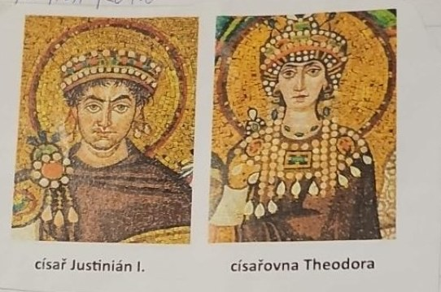
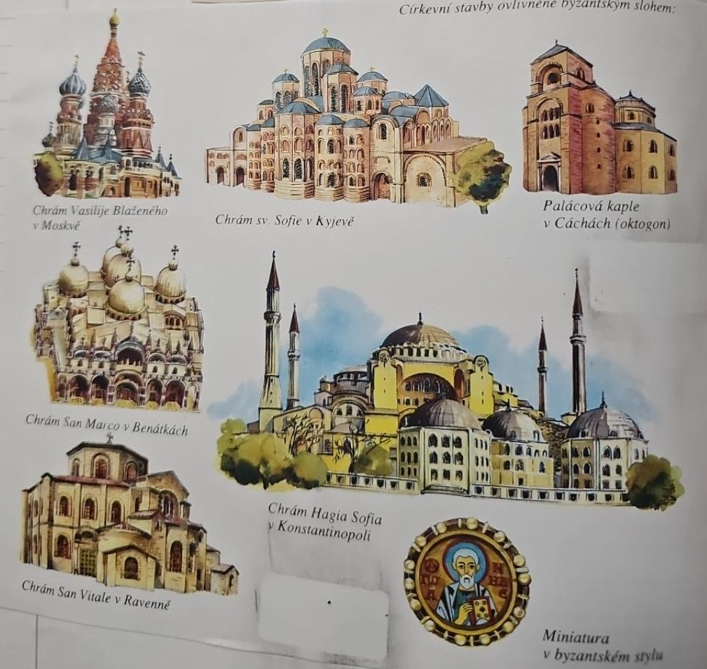
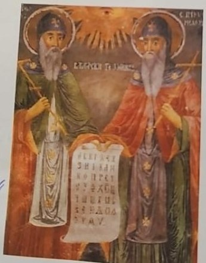
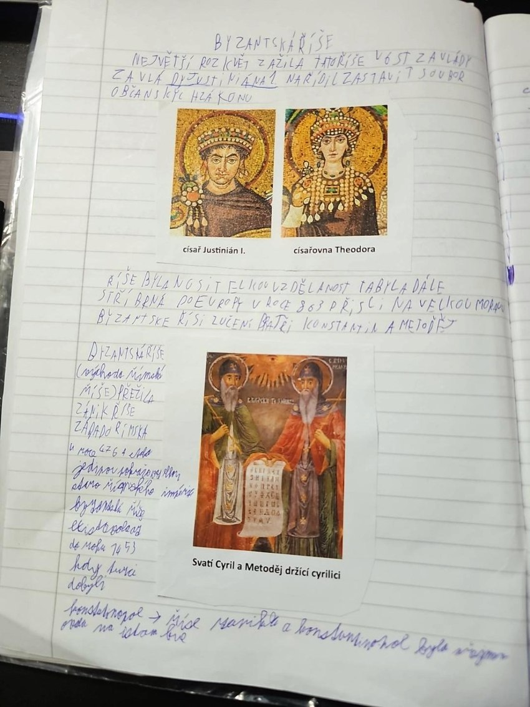
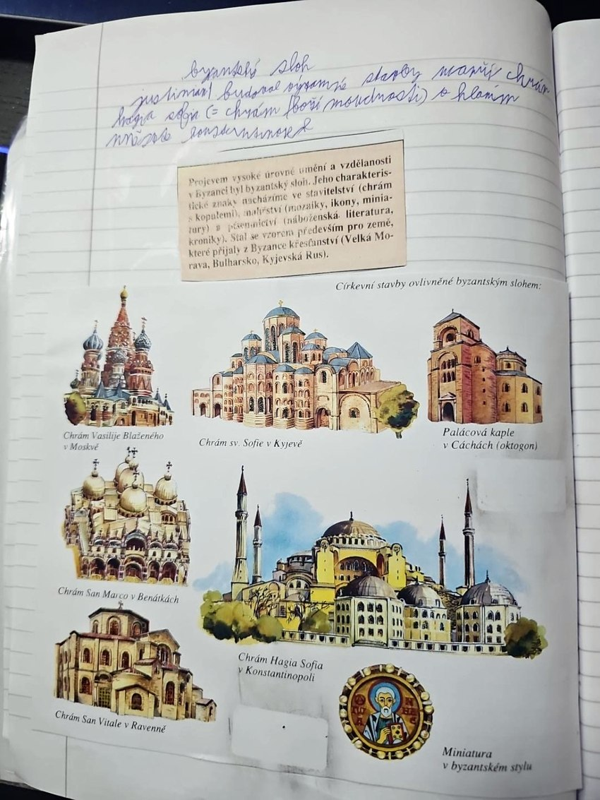

# Byzantská říše

> **Ve zkratce:** Východní polovina Římské říše přežila pád Západu o tisíc let. Dala Evropě římské právo, chrámy s kopulemi a přes Konstantina a Metoděje i první slovanské písmo.

## Pokračování římské říše

Po zániku **Západořímské říše roku 476** východní část Římské říše pokračovala. Její obyvatelé se sami pokládali za Římany. **Byzantská říše** je název používaný pozdějšími historiky. Hlavním městem byla **Konstantinopol**.

## Justinián I. a právo

V **6. století** zažila říše za císaře **Justiniána I.** velký mocenský a kulturní rozmach. Nechal uspořádat starší římské zákony a právní texty do souboru známého jako **Corpus iuris civilis**. Ten pomohl zachovat římské právo a později ovlivnil evropskou právní tradici. Sešitové „soubor občanských zákonů“ je školní zkratka: nešlo o dnešní občanský zákoník.

## Umění, vzdělanost a Hagia Sofia

Byzantské umění poznáš podle **kopulí**, **mozaik** a **ikon**. V Konstantinopoli nechal Justinián postavit velkolepý chrám **Hagia Sofia**, tedy chrám Boží Moudrosti. Byzanc byla důležitým střediskem vzdělanosti a její náboženské i umělecké vlivy pronikaly do dalších zemí.

## Konstantin a Metoděj

Z Byzance přišli roku **863** na Velkou Moravu bratři **Konstantin (později Cyril)** a **Metoděj**. Přinesli křesťanské texty ve slovanském jazyce. Konstantin vytvořil pro jejich zápis **hlaholici**. **Cyrilice vznikla později** v prostředí jejich žáků; obrázek v sešitě s popiskem „držící cyrilici“ je tedy zavádějící.

## Konec říše

Roku **1453** dobyli Konstantinopol **Osmanští Turci** a Byzantská říše zanikla. Tvrzení, že město bylo přesně tehdy přejmenováno na Istanbul, je nepřesné: pojmenování Istanbul se užívalo už dříve a mezinárodní úřední podoba názvu se ustálila až mnohem později.

## Zapamatuj si

**476 východní Řím pokračuje → 6. století Justinián, zákony a Hagia Sofia → 863 Konstantin a Metoděj s hlaholicí → 1453 dobytí Konstantinopole.**

## Paměťový obraz

Byzanc je pravá věž hradu: začni u rozlomeného sloupu nahoře vlevo a pak jdi pravou věží zdola nahoru.

| Zastávka | Obraz | Co si vybavit |
|---|---|---|
| 1 | Rozlomený římský sloup | **476:** Západořímská říše zaniká, východní pokračuje. |
| 7 | Kniha zákonů | **Justinián:** uspořádání římského práva v 6. století. |
| 8 | Kopule a mozaiky | **Hagia Sofia:** byzantské stavitelství a umění. |
| 9 | Kniha s hlaholicí | **863:** Konstantin a Metoděj přicházejí na Velkou Moravu. |
| 10 | Brána Konstantinopole | **1453:** Osmané město dobývají, Byzanc zaniká. |

## Zápis ze sešitu

Fotky stránek sešitu

