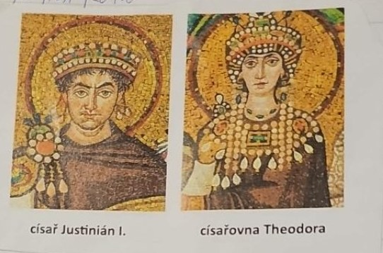
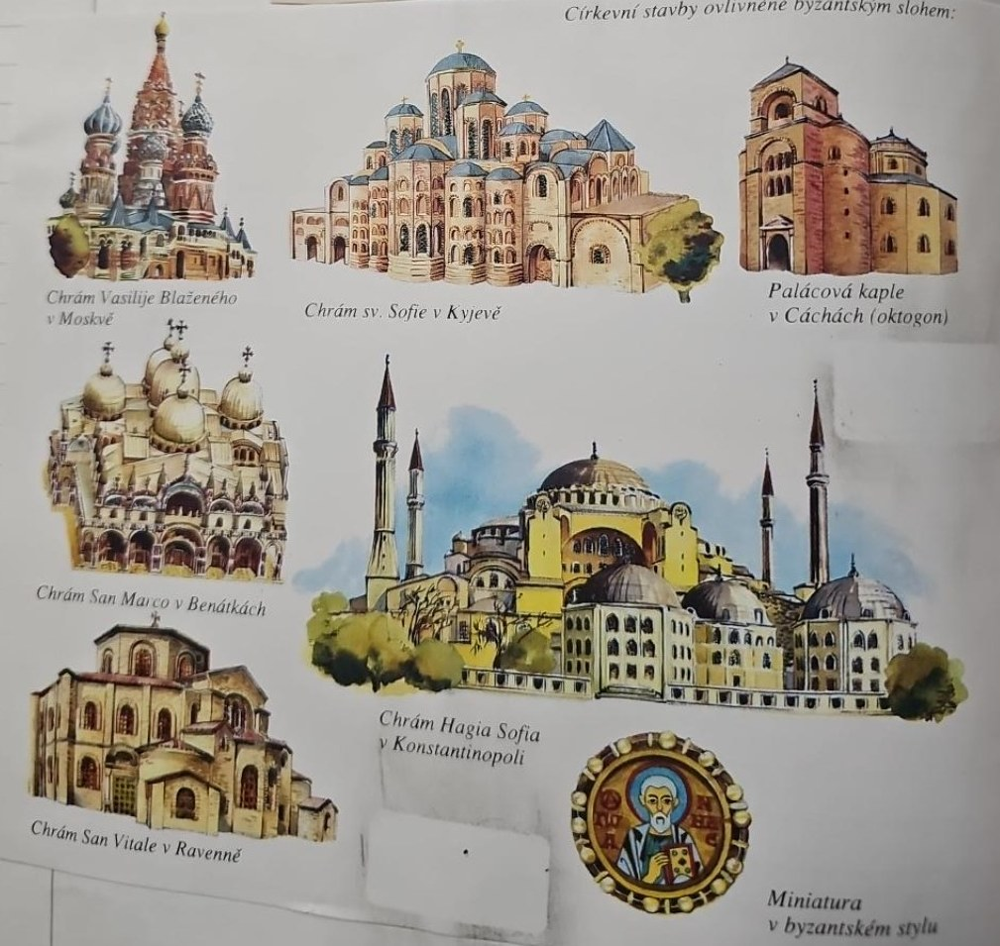
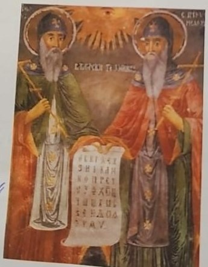
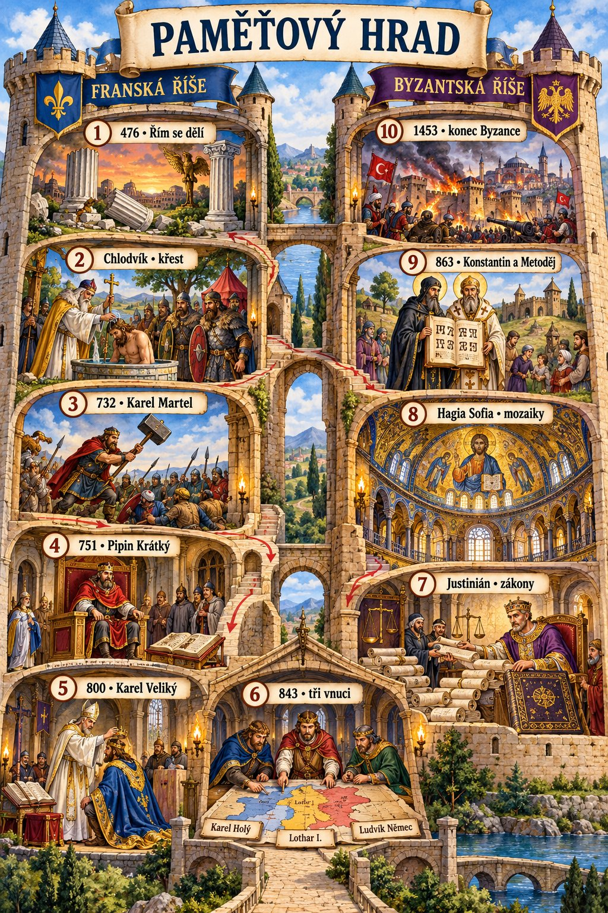
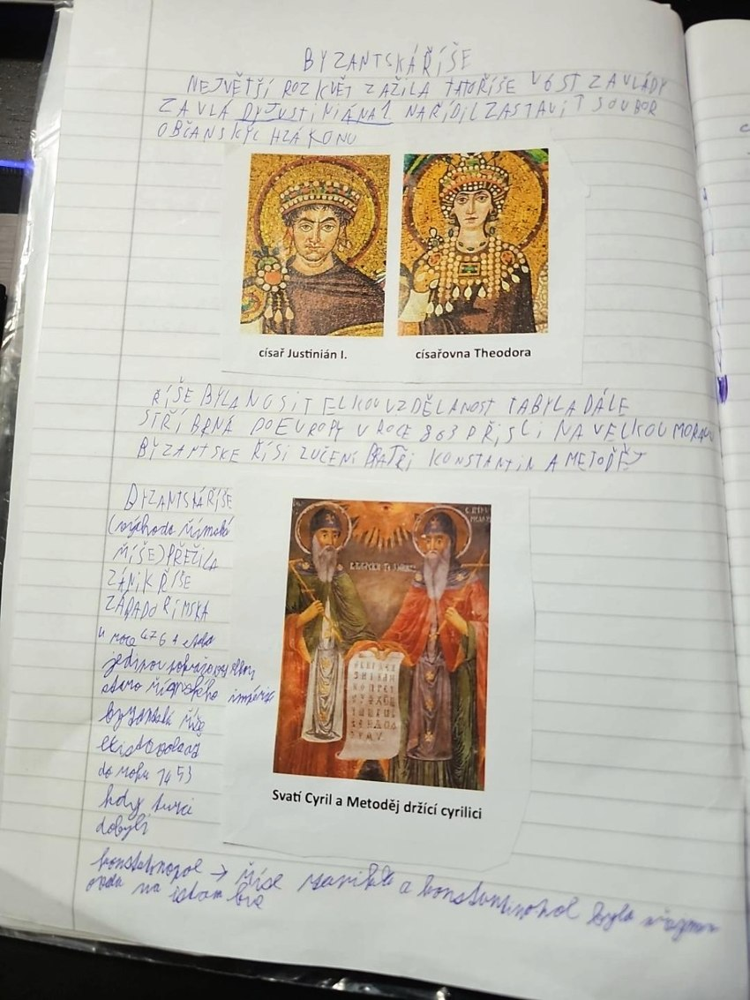
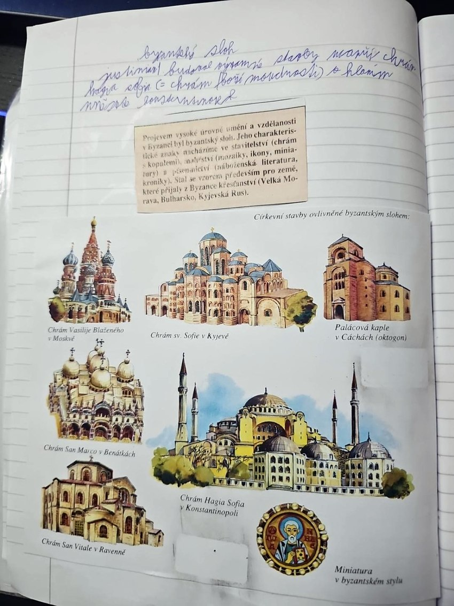

# Byzantská říše

> **Ve zkratce:** Byzantská (Východořímská) říše přežila zánik Západořímské říše roku 476 a trvala až do roku 1453. Největší rozkvět zažila za Justiniána I. a z Byzance přišli na Velkou Moravu Konstantin a Metoděj.

## Pokračování římské říše

**Byzantská říše** (také **Východořímská říše**) **přežila zánik Západořímské říše** v roce **476**. Stala se tak **jedinou pokračovatelkou starořímského impéria**. Hlavním městem byla **Konstantinopol**.

**Proč je to důležité:** na západě Římská říše zanikla, ale na východě její vzdělanost, zákony a umění pokračovaly dalších tisíc let.

## Justinián I.

**Největší rozkvět** zažila tato říše v **6. století** za vlády <mark>Justiniána I.</mark> Nařídil **sestavit soubor občanských zákonů**: dal dohromady staré římské zákony.

**Proč je to důležité:** díky tomu se **římské právo zachovalo** a evropské státy podle něj později tvořily vlastní zákony.

## Byzantský sloh

Justinián budoval **významné stavby**, například chrám **Hagia Sofia** (= **chrám Boží moudrosti**) v hlavním městě **Konstantinopoli**.

Projevem vysoké úrovně umění a vzdělanosti v Byzanci byl **byzantský sloh**. Jeho znaky:

- **stavitelství:** chrámy s **kopulemi**,
- **malířství:** **mozaiky**, **ikony**, **miniatury**,
- **písemnictví:** **náboženská literatura**, **kroniky**.

Byzantský sloh se stal **vzorem** především pro země, které přijaly **z Byzance křesťanství**: **Velká Morava**, **Bulharsko**, **Kyjevská Rus**.

Církevní stavby ovlivněné byzantským slohem (obrázky v sešitě): chrám Vasilije Blaženého v Moskvě, chrám sv. Sofie v Kyjevě, palácová kaple v Cáchách (oktogon), chrám San Marco v Benátkách, chrám Hagia Sofia v Konstantinopoli, chrám San Vitale v Ravenně.

## Konstantin a Metoděj

Říše byla **nositelkou vzdělanosti** a ta byla dále **šířena po Evropě**. V roce **863** přišli **z Byzantské říše** na **Velkou Moravu** učení bratři **Konstantin a Metoděj**.

**Proč je to důležité:** přinesli k nám vzdělanost a křesťanství ve slovanském jazyce, kterému lidé rozuměli.

## Konec říše

Byzantská říše existovala **do roku 1453**, kdy **Turci dobyli Konstantinopol**. Říše **zanikla** a Konstantinopol byla přejmenována na **Istanbul**.

Souvislost: roku **1054** se církev v Konstantinopoli rozešla s Římem (téma Velké schizma).

## Zapamatuj si

**476 Západořímská říše zaniká, Byzanc pokračuje → 6. století Justinián I.: zákony a Hagia Sofia → byzantský sloh: kopule, mozaiky, ikony → 863 Konstantin a Metoděj na Velké Moravě → 1453 Turci dobyli Konstantinopol, z ní je Istanbul.**

## Paměťový obraz

Byzanc je pravá věž hradu: začni u rozlomeného sloupu nahoře vlevo a pak jdi pravou věží zdola nahoru.

| Zastávka | Obraz | Co si vybavit |
|---|---|---|
| 1 | Rozlomený římský sloup | **476:** Západořímská říše zaniká, východní pokračuje. |
| 7 | Kniha zákonů | **Justinián:** uspořádání římského práva v 6. století. |
| 8 | Kopule a mozaiky | **Hagia Sofia:** byzantské stavitelství a umění. |
| 9 | Kniha s hlaholicí | **863:** Konstantin a Metoděj přicházejí na Velkou Moravu. |
| 10 | Brána Konstantinopole | **1453:** Osmané město dobývají, Byzanc zaniká. |

### Ověření proti zápiskům

Popisek obrázku v sešitě „držící **cyrilici**“ je zavádějící: Konstantin vytvořil **hlaholici**, cyrilice vznikla až později u jeho žáků. Jméno **Istanbul** se pro město užívalo postupně, úředně se ustálilo až mnohem později.

## Zápis ze sešitu

Fotky stránek sešitu

