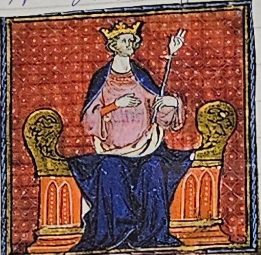
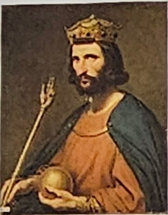
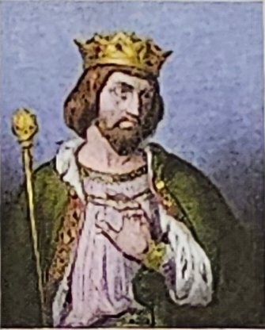
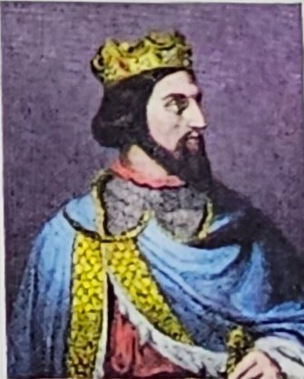
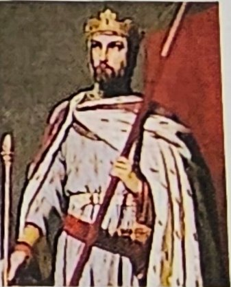
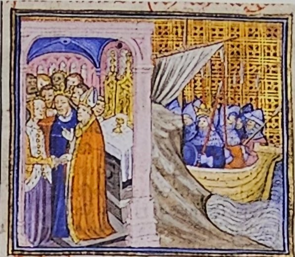
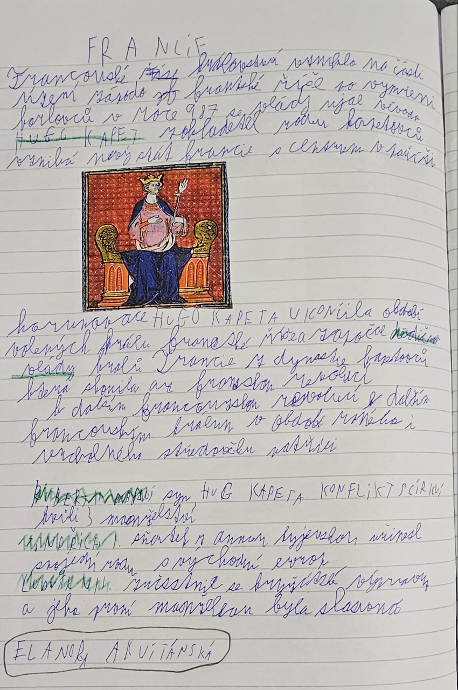
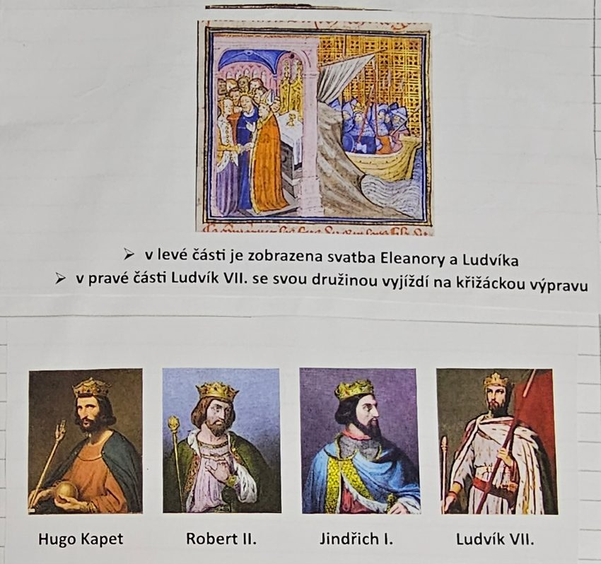

# Francie

> **Ve zkratce:** Francouzské království vzniklo ze západofranské říše. Roku 987 se po vymření Karlovců ujal vlády Hugo Kapet a založil dynastii Kapetovců, ve které se královský trůn dědil.

## Hugo Kapet a vznik Francie

**Francouzské království** vzniklo na části území **západofranské říše**. To je západní díl, který Franská říše dostala při rozdělení roku 843 (téma Franská říše).

V západofranské říši vládli **Karlovci**, potomci Karla Velikého. Když jejich rod **vymřel**, ujal se roku **987** vlády vévoda **Hugo Kapet**. Stal se **zakladatelem rodu Kapetovců**. Vznikl nový stát, **Francie**, s centrem v **Paříži**.

## Proč je Hugo Kapet důležitý

Korunovace Huga Kapeta **ukončila období volených králů** Franské říše. Od té doby **dědili** trůn králové z dynastie **Kapetovců**, vždy z otce na syna.

**Proč je to důležité:** když se král volí, šlechtici se o trůn hádají a po každé smrti krále hrozí boje. Když se trůn dědí, je předem jasné, kdo bude vládnout, a země je klidnější a silnější. Kapetovci vládli Francii **velmi dlouho**: jejich vláda skončila až **francouzskou revolucí**, mnoho staletí po Hugovi.

## Další Kapetovci

K dalším francouzským králům raného a vrcholného středověku patřili:

- **Robert II.**, syn Huga Kapeta. Dostal se do **konfliktu s církví** kvůli svým **třem manželstvím**. Ve středověku určovala pravidla manželství církev, a král se jimi musel řídit stejně jako ostatní.
- **Jindřich I.** se oženil s **Annou Kyjevskou**, princeznou z Kyjevské Rusi. Tím **spojil svůj rod s východní Evropou**. Sňatky byly pro panovníky způsob, jak získat spojence.
- **Ludvík VII.** se zúčastnil **křížové výpravy**. To byla výprava křesťanských rytířů do Svaté země, kde žil Ježíš. Jeho **první manželkou** byla slavná **Eleonora Akvitánská** (v sešitě *Eleanora*).

## Zapamatuj si

**Západofranská říše → 987 vymřeli Karlovci → Hugo Kapet, zakladatel Kapetovců, centrum Paříž → konec volených králů, trůn se dědí (až do francouzské revoluce) → Robert II. (3 manželství, spor s církví), Jindřich I. (Anna Kyjevská), Ludvík VII. (křížová výprava, Eleonora Akvitánská).**

## Paměťový obraz

- **Kapuce na hlavě krále:** Hugo *Kapet* si nasadí korunu roku 987 v Paříži; koruna se pak dědí z otce na syna.
- **Tři nevěsty a zamračený biskup:** Robert II. a spor s církví.
- **Nevěsta z daleké Rusi:** Jindřich I. a Anna Kyjevská.
- **Svatba a loď:** Ludvík VII. si bere Eleonoru a odplouvá na křížovou výpravu.

### Ověření proti zápiskům

Hugo Kapet byl roku 987 na trůn **ještě zvolen** šlechtou. Dědičnost zajistil tím, že nechal hned korunovat i svého syna Roberta. Hlavní rod Kapetovců později vymřel a vládly jeho **vedlejší větve** (Valois, Bourboni). Proto sešit říká, že dynastie skončila až francouzskou revolucí.

## Zápis ze sešitu

Fotky stránek sešitu

