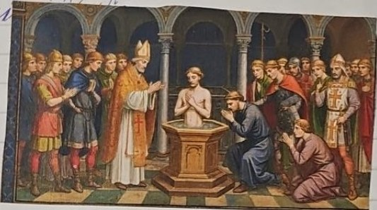
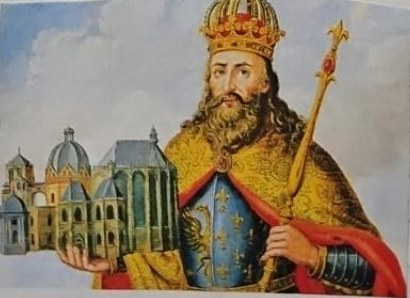
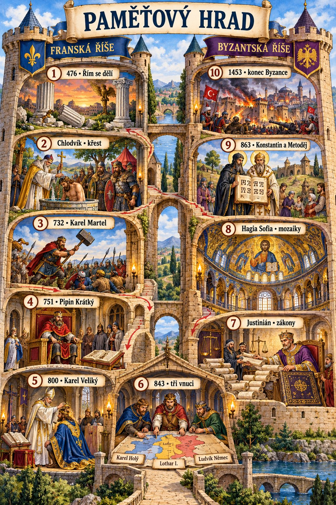
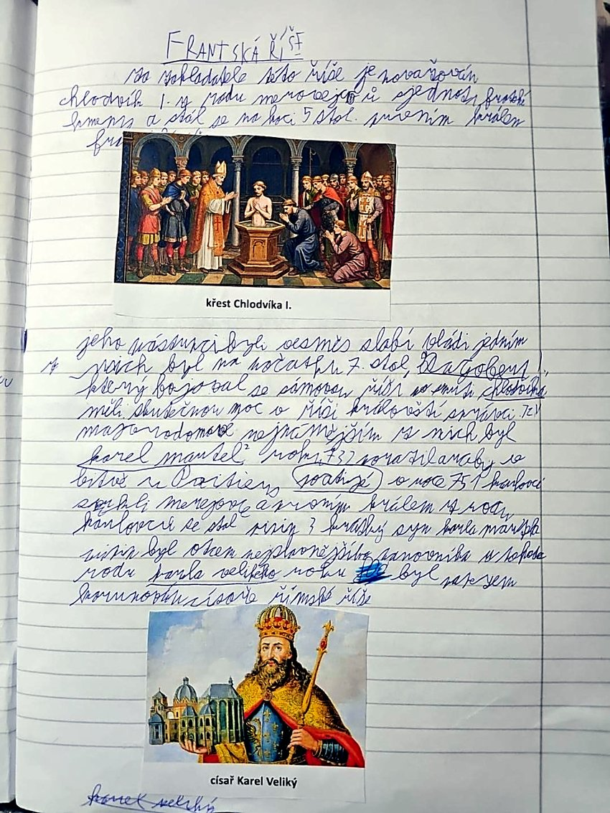
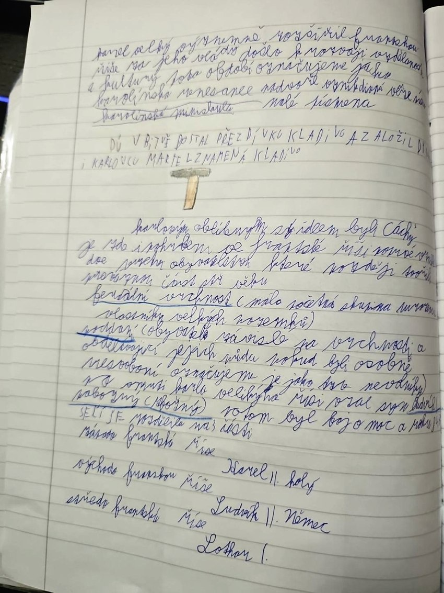

# Franská říše

> **Ve zkratce:** Franskou říši založil Chlodvík I. z rodu Merovejců. Skutečnou moc pak získali majordomové a roku 751 Karlovci sesadili Merovejce. Karel Veliký byl roku 800 korunován císařem; po smrti jeho syna se říše rozdělila na tři části.

## Chlodvík I. a Merovejci

Za zakladatele Franské říše je považován **Chlodvík I.** z rodu **Merovejců**. **Sjednotil franské kmeny** a na konci **5. století** se stal **prvním králem Franků**. Nechal se **pokřtít** (obrázek v sešitě).

Jeho nástupci byli většinou **slabí vládci**. Jedním z nich byl na počátku 7. století <mark>Dagobert I.</mark>, který **bojoval se Sámovou říší** (Sámova říše byla první známý stát Slovanů, i na našem území).

## Majordomové a Karlovci

Po smrti <mark>Chlodvíka</mark> měli skutečnou moc v říši **královští správci**, tzv. **majordomové**. Král tedy formálně vládl, ale rozhodoval jeho správce.

Nejznámějším z nich byl <mark>Karel Martel</mark>. Roku **732** porazil **Araby** v bitvě u **Poitiers**. V bitvě dostal přezdívku **Kladivo**: *Martel* znamená **kladivo**.

**Proč je to důležité:** Karel Martel zastavil postup Arabů do západní Evropy (souvislost s tématem Arabská říše a islám).

V roce **751** Karlovci <mark>sesadili</mark> **Merovejce** a prvním králem z rodu **Karlovců** se stal **Pipin III. Krátký**, syn Karla Martela.

## Karel Veliký

Pipin byl otcem nejznámějšího panovníka tohoto rodu, <mark>Karla Velikého</mark>. Roku **800** byl Karel **papežem korunován císařem** římské říše.

**Proč je to důležité:** po zániku Západořímské říše měl západ Evropy zase **císaře**. Na to později navázala Svatá říše římská.

Karel Veliký **významně rozšířil** Franskou říši. Za jeho vlády došlo k **rozvoji vzdělanosti a kultury**. Toto období označujeme jako <mark>karolinská renesance</mark> (*renesance* = obnova). Zároveň vzniklo nové písmo, <mark>karolinská minuskula</mark>: **malá písmena**, jaká píšeme dodnes.

Karlovým **oblíbeným sídlem** byly **Cáchy**. Je tam i **pohřben**.

Souvislost: Karel udržoval styky s chalífou **Harúnem ar-Rašídem**, který mu poslal **bílého slona** (téma Arabská říše a islám).

### Pro zajímavost

- **Jak vypadal:** podle rozboru jeho kostí měřil Karel asi **184 cm**, byl tedy vyšší než 99 % lidí své doby. Místo legendárního plnovousu měl nejspíš jen bohatý **knír**.
- **Rodina:** měl **pět manželek** (nebo čtyři) a odhaduje se, že měl nejméně **18 dětí**. Dcerám **nedovolil vdát se**: podle Einharda je moc miloval, historici ale myslí, že nechtěl mít mocné zetě, kteří by ho mohli ohrozit.
- **Einhard:** učenec a rádce na Karlově dvoře. Napsal Karlův životopis **Vita Karoli Magni**, ze kterého víme, jaký Karel byl.
- **Latina a psaní:** Karel se naučil **latinsky** tak dobře jako svou rodnou řečí. **Psaní** mu ale nešlo: tabulky na procvičování písma si prý dával **pod polštář**.

## Vrchnost a poddaní

Ve Franské říši vznikly **dvě skupiny obyvatel**, které pak tvořily většinu středověké společnosti:

- <mark>feudální vrchnost</mark>: **málo početná** skupina **mocných vlastníků velkých pozemků**,
- <mark>poddaní</mark>: obyvatelé **závislí na vrchnosti**, kteří **obdělávali její půdu**. Pokud byli **osobně nesvobodní**, říkáme jim **nevolníci**.

**Proč je to důležité:** takhle byla společnost uspořádaná po celý středověk (téma Středověká společnost a církev).

## Rozdělení říše

Po smrti Karla Velikého převzal říši jeho syn **Ludvík** <mark>Nábožný (Zbožný)</mark>. Potom nastal **boj o moc** a roku **843** se říše **rozdělila na tři části** mezi Karlovy vnuky:

| Část říše | Vnuk Karla Velikého | Co z ní později vzniklo |
|---|---|---|
| **západofranská** | **Karel II. Holý** | Francie |
| **východofranská** | **Ludvík II. Němec** | Německo, Svatá říše římská |
| **středofranská** | **Lothar I.** | pás od Severního moře do Itálie |

## Zapamatuj si

**Chlodvík I. (Merovejci) sjednotil Franky → Dagobert I. bojoval se Sámovou říší → majordomové → Karel Martel „Kladivo“ 732 u Poitiers → 751 Karlovci sesadili Merovejce, Pipin Krátký králem → Karel Veliký 800 císařem, karolinská renesance, minuskula, Cáchy → vrchnost a poddaní → Ludvík Nábožný → 843 rozdělení na tři části.**

## Paměťový obraz

Projdi v duchu levou věž hradu odshora dolů a u každé zastávky řekni, co se stalo.

| Zastávka | Obraz | Co si vybavit |
|---|---|---|
| 2 | Křtitelnice | **Chlodvík:** sjednocení Franků a přijetí křesťanství. |
| 3 | Kladivo | **732:** Karel Martel vítězí u Poitiers. |
| 4 | Trůn | **751:** Pipin Krátký se stává králem; Karlovci. |
| 5 | Koruna a knihy | **800:** Karel Veliký císařem; školy a karolinská renesance. |
| 6 | Mapa rozdělená na tři díly | **843:** Karel Holý západ, Lothar střed, Ludvík Němec východ. |

### Opravy z poznámek

Sešit píše, že Karel Martel „založil dynastii Karlovců“. Rod se podle něj opravdu jmenuje, ale **prvním králem** z Karlovců byl až jeho syn **Pipin Krátký** (751). Karel Martel byl majordomus, ne král. Ludvíkovi se v učebnicích říká i **Pobožný**.

## Zápis ze sešitu

Fotky stránek sešitu

