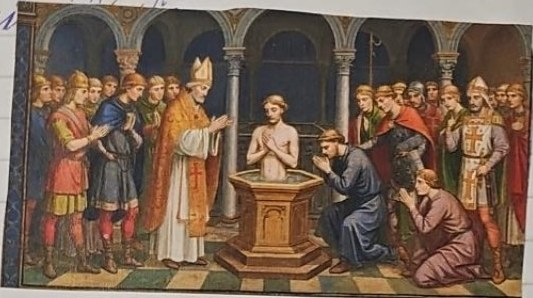
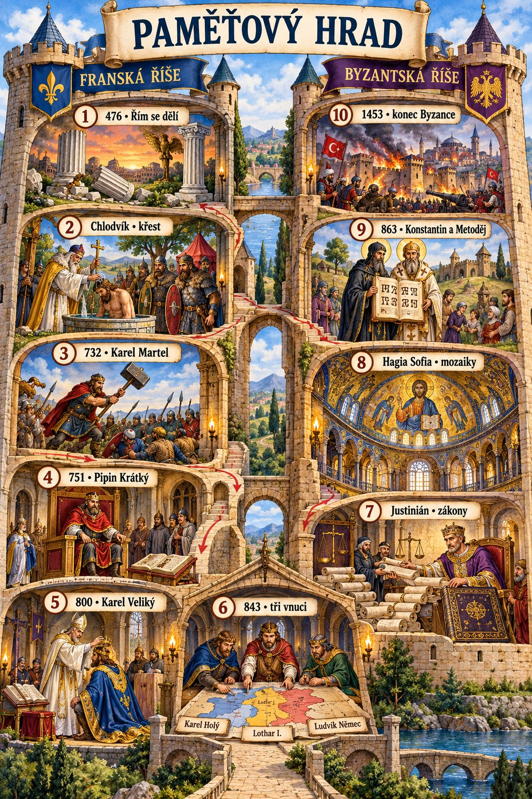
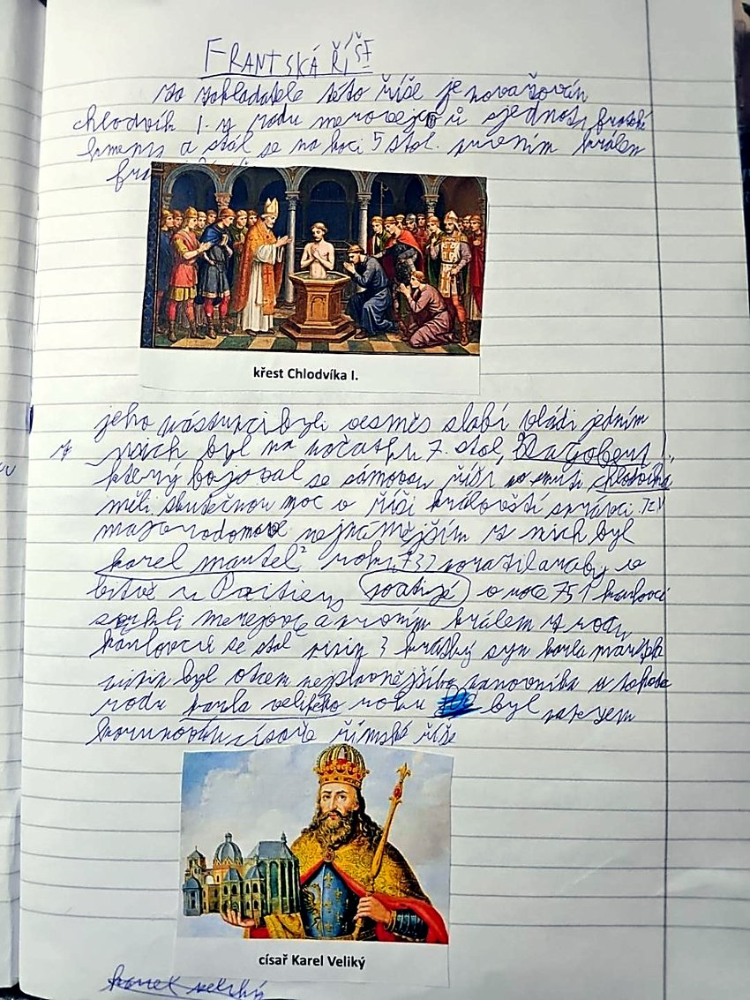
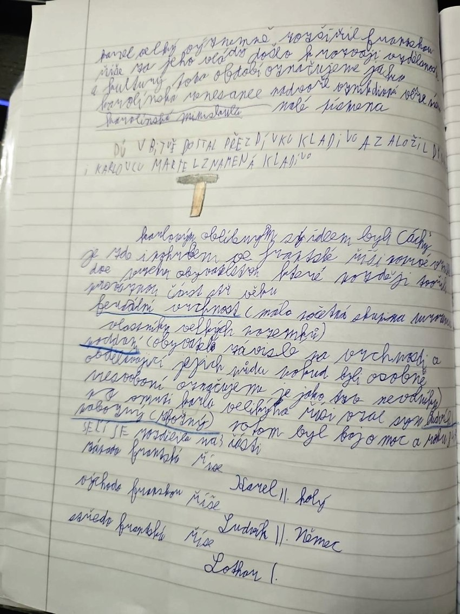

# Franská říše

> **Ve zkratce:** Frankové vybudovali na troskách Západořímské říše největší křesťanský stát západní Evropy. Vrcholu dosáhli za Karla Velikého; jeho vnuci si říši roku 843 rozdělili a z dílů později vyrostla Francie a Německo.

## Jak vznikla

Po zániku Západořímské říše vznikala v západní Evropě germánská království. **Chlodvík I.** z rodu **Merovejců** sjednotil velkou část Franků a přijal křesťanství. Získal tím podporu církve i části původního římského obyvatelstva.

Pozdější merovejští králové ztráceli moc. Důležití byli **majordomové**, původně správci královského dvora. **Karel Martel** jako majordomus porazil roku **732** vojsko Umajjovského chalífátu u **Poitiers/Tours**. Jeho syn **Pipin Krátký** se roku **751** stal králem: začala vláda **Karlovců**. Přezdívka *Martel* souvisí s kladivem.

## Karel Veliký

Pipinův syn **Karel Veliký** výrazně rozšířil říši. Roku **800** jej papež v Římě korunoval císařem. Podporoval školy, vzdělance a opisování knih. Rozkvět vzdělanosti nazýváme **karolinskou renesancí**. V jejím prostředí se rozšířilo čitelné písmo **karolinská minuskula**. Důležitým Karlovým sídlem byly **Cáchy**. Karel udržoval styky i s bagdádským chalífou **Harúnem ar-Rašídem**, který mu poslal slona jménem **Abú al-Abbás**.

Karelův syn **Ludvík Pobožný** vládl po jeho smrti. Jeho synové bojovali o moc a **verdunskou smlouvou roku 843** si říši rozdělili:

| Vnuk Karla Velikého | Část říše | Přibližná souvislost s dnešní mapou |
|---|---|---|
| **Karel Holý** | západofranská | základ pozdější Francie |
| **Ludvík Němec** | východofranská | základ pozdějšího Německa |
| **Lothar I.** | středofranská | pás od Severního moře k severní Itálii |

Hranice a státy nebyly totožné s těmi dnešními. Středofranská část se dále dělila. Na východofranské království později navázala říše Oty I.

## Pojmy ze zápisků

- **Majordomus:** správce královského dvora, který za slabých králů získal skutečnou politickou moc.
- **Vrchnost:** držitel panství a práv vůči poddaným; vztahy se v různých dobách lišily.
- **Poddaní:** lidé podléhající vrchnosti. Nelze všechny obyvatele rané Franské říše jednoduše označit za nevolníky.
- **Karolinská renesance:** obnova vzdělanosti v Karlově říši, nikoli renesance 15. a 16. století.

## Zapamatuj si

**Chlodvík sjednocuje a přijímá křest → Martel 732 vítězí u Poitiers → Pipin 751 zakládá královskou vládu Karlovců → Karel Veliký je 800 korunován císařem → vnuci dělí říši 843.**

## Paměťový obraz

Projdi v duchu levou věž hradu odshora dolů a u každé zastávky řekni, co se stalo.

| Zastávka | Obraz | Co si vybavit |
|---|---|---|
| 2 | Křtitelnice | **Chlodvík:** sjednocení Franků a přijetí křesťanství. |
| 3 | Kladivo | **732:** Karel Martel vítězí u Poitiers. |
| 4 | Trůn | **751:** Pipin Krátký se stává králem; Karlovci. |
| 5 | Koruna a knihy | **800:** Karel Veliký císařem; školy a karolinská renesance. |
| 6 | Mapa rozdělená na tři díly | **843:** Karel Holý západ, Lothar střed, Ludvík Němec východ. |

### Opravy z poznámek

Bitva Chlodvíkova potomka **Dagoberta I.** se Sámovou říší se obvykle označuje jako bitva u **Wogastisburgu**, její přesné místo a datování nejsou jisté. Vyprávění o „jednotných zákonech pro všechny obyvatele“ je pro tak rozmanitou a dlouho trvající říši příliš jednoduché. Přezdívku **Kladivo** měl Karel Martel; **Karlovskou dynastii na královském trůně** zahájil až jeho syn Pipin.

## Zápis ze sešitu

Fotky stránek sešitu

