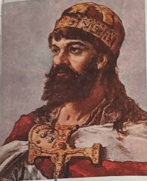
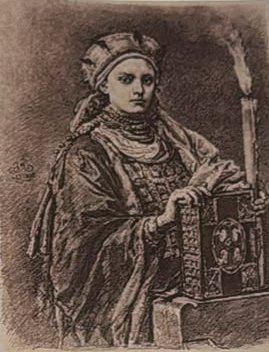
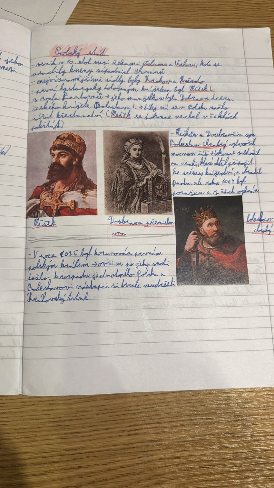

# Polský stát

> **Ve zkratce:** V 10. století vznikl mezi Odrou a Vislou polský stát pod vládou Piastovců. Měšek I. přijal křesťanství díky české manželce Doubravce a jeho syn Boleslav Chrabrý se roku 1025 stal prvním polským králem.

## Vznik Polska a Měšek I.

Polský stát vznikl v **10. století** mezi řekami **Odrou** a **Vislou**. Žily tu kmeny **západních Slovanů**, tedy příbuzní Čechů a Slováků; proto si česky a polsky dodnes trochu rozumíme. Nejsilnější kmen se jmenoval **Polané** (od slova *pole*) a podle nich dostala název celá země.

Nejvýznamnějšími sídly byla **Hnězdno** a **Krakov**. Hnězdno bylo první centrum státu, Krakov se hlavním městem stal později.

Prvním **historicky doloženým** knížetem byl **Měšek I.** z rodu **Piastovců**. „Historicky doložený“ znamená, že o něm píší skutečné písemné prameny. O knížatech před ním známe jen pověsti.

Měšek se oženil s českou princeznou **Doubravkou** (v sešitě *Dobrava*), dcerou českého knížete **Boleslava I.** Byla to tedy **Přemyslovna**. Doubravka byla křesťanka a díky ní se v Polsku začalo šířit **křesťanství**. Měšek se kvůli ní nechal **pokřtít**. Proč to bylo pro knížete výhodné? Křesťanského panovníka brali okolní křesťanští vládci jako rovného partnera a neměli záminku napadat ho kvůli víře.

## Boleslav Chrabrý, první polský král

Syn Měška a Doubravky, **Boleslav Chrabrý**, vytvořil **mocnou říši**. *Chrabrý* znamená „statečný“. Po matce byl napůl Přemyslovec, Čechy tedy dobře znal.

V Čechách se tehdy o trůn hádali Přemyslovci mezi sebou. Boleslav toho využil: **zaútočil na Čechy**, chtěl je připojit ke svému státu a **obsadil Prahu**. Roku **1004** byl ale **poražen a z Čech vyhnán**.

Roku **1025** byl Boleslav **korunován prvním polským králem**. Po jeho smrti se ale jednotné Polsko **rozpadlo** a jeho nástupci si královský titul **trvale neudrželi**. Podobně to bylo u nás: i první čeští králové měli titul jen pro sebe (Vratislav II., téma Svatá říše římská).

### Pro zajímavost

- **Lech, Čech a Rus:** podle pověsti byli tři bratři. Čech se usadil pod horou Říp, Lech šel dál na sever. Tam uviděl na stromě **hnízdo bílého orla** a založil u něj hrad **Hnězdno** (od slova *hnízdo*). **Bílý orel** je dodnes ve znaku Polska.
- **Piast:** rod Piastovců má jméno po pověstném předkovi **Piastovi**, prostém rolníkovi, kterého si lidé zvolili za knížete.
- **Wawel:** na krakovském hradě **Wawel** byli později korunováni polští králové a jsou tam i pohřbeni, podobně jako čeští králové na Pražském hradě.

## Zapamatuj si

**10. století: Polsko mezi Odrou a Vislou → Piastovci → Měšek I. + česká Doubravka = křesťanství → Boleslav Chrabrý obsadil Prahu, 1004 vyhnán → 1025 první polský král → po jeho smrti rozpad.**

## Paměťový obraz

- **Orel v hnízdě:** Hnězdno, bílý orel ve znaku, Krakov.
- **Česká nevěsta s křížem:** Doubravka přiváží z Čech křesťanství Měškovi.
- **Statečný syn na Pražském hradě:** Boleslav Chrabrý obsadí Prahu, 1004 utíká, 1025 si nasadí královskou korunu.

### Ověření proti zápiskům

Kde přesně byl Měšek pokřtěn, **prameny neříkají**. Sešit uvádí Čechy, je to ale jen tradiční výklad. Jisté je, že ke křtu ho přivedla Doubravka. **Krakov** a **Hnězdno**: prvním centrem bylo Hnězdno, Krakov se hlavním sídlem stal až později.

## Zápis ze sešitu

Fotka stránky sešitu

