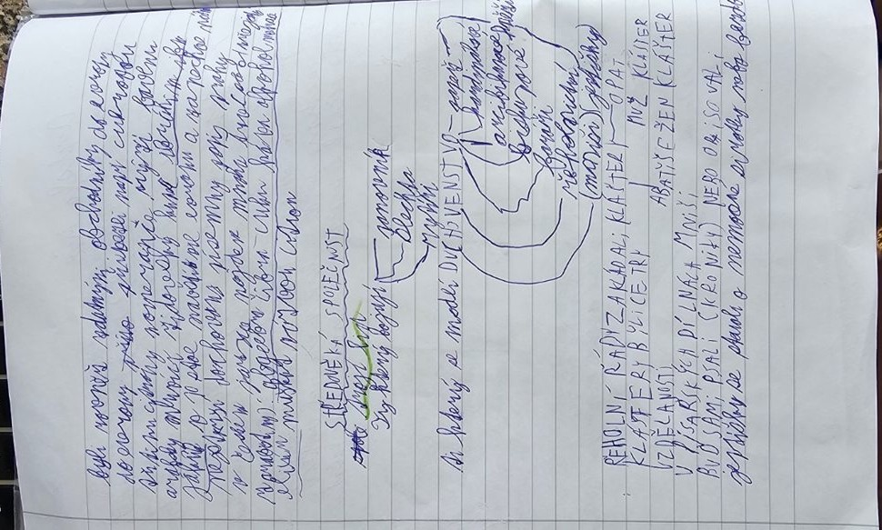

# Středověká společnost a církev

> **Ve zkratce:** Středověká společnost se dělila na ty, kdo se modlí, kdo bojují a kdo pracují. Kláštery nebyly jen místem modlitby, ale i škol, nemocnic a opisování knih.

## Tři skupiny společnosti

Středověcí autoři často používali zjednodušený model **tří skupin**:

1. **Duchovenstvo** – ti, kteří se modlí.
2. **Šlechta** – ti, kteří bojují a chrání.
3. **Pracující obyvatelé**, zejména rolníci – ti, kteří pracují a zajišťují obživu.

Skutečná středověká společnost však byla pestřejší. Ve městech žili například **řemeslníci, kupci, obchodníci, nádeníci a služebnictvo**.

## Duchovenstvo

V západní církvi stál na vrcholu **papež**. Pod ním působili **arcibiskupové, biskupové a kněží**. **Mniši** a **jeptišky** žili v klášterech podle pravidel řádu.

## Kláštery

Kláštery byly místy modlitby, ale také práce, vzdělávání, hospodaření, péče o nemocné a **opisování knih**. Díky tomu se zachovalo mnoho starších textů.

| Řád | Co si vybavit |
|---|---|
| Benediktini | Kláštery; modlitba a práce (*ora et labora*) |
| Cisterciáci | Přísný řeholní život; hospodaření |
| Premonstráti | Klášterní život a duchovní služba |
| Františkáni | Dobrovolná chudoba, kázání, pomoc lidem |
| Dominikáni | Kázání, vzdělání, studium teologie |

**Františkáni a dominikáni** patřili k žebravým řádům a významně působili ve městech.

## Zapamatuj si

**Kněz se modlí, rytíř bojuje, rolník pracuje.** V klášteře mnich nejen žije nábožensky, ale také **opisuje rukopisy**.

## Paměťový obraz

- **Hrad a klášter:** kněz se modlí, rytíř bojuje, rolník pracuje; mnich opisuje knihu.

## Zápis ze sešitu

Fotky stránek sešitu

