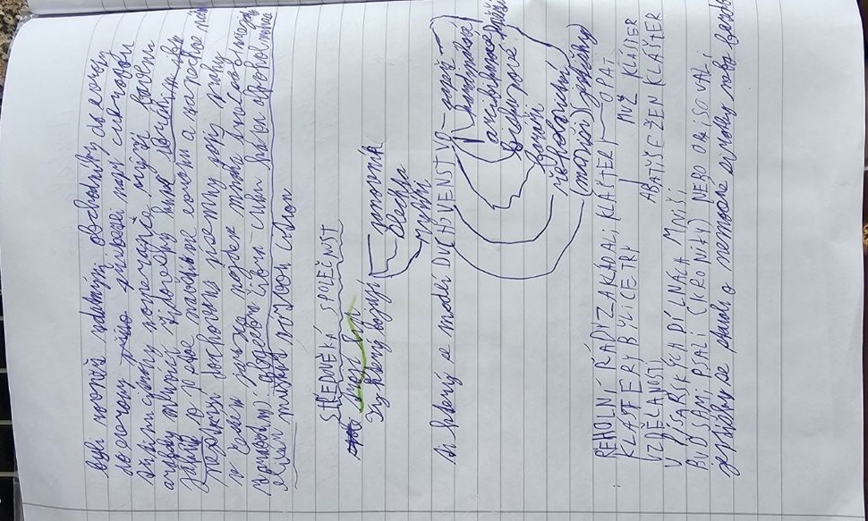
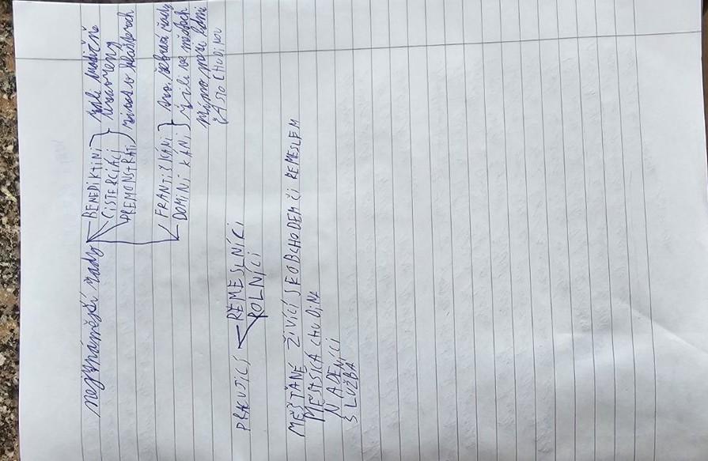

# Středověká společnost a církev

> **Ve zkratce:** Středověká společnost se dělila na ty, kdo bojují, kdo se modlí, a kdo pracují. Kláštery byly centry vzdělanosti: mniši v nich psali a opisovali knihy.

## Tři skupiny společnosti

Středověkou společnost tvoří <mark>tři</mark> skupiny:

1. **Ti, kteří bojují:** **panovník**, **šlechta**, **rytíři**.
2. **Ti, kteří se modlí:** **duchovenstvo**.
3. **Pracující:** **řemeslníci** a **rolníci**.

**Proč je to důležité:** každý měl své místo a svůj úkol. Šlechta chránila ostatní bojem, duchovní se za ně modlili a pracující je živili.

Ve městech žili **měšťané**, kteří se živili **obchodem či řemeslem**. Dál tam žila **městská chudina**, **nádeníci** (pracovali za denní mzdu, kde se zrovna dalo) a **služba** (služebnictvo).

## Duchovenstvo

Duchovenstvo mělo pevné pořadí, od nejvyššího:

**papež → kardinálové → arcibiskupové → biskupové → faráři (kněží)**

K duchovenstvu patřili i **řeholníci (mniši)** a **jeptišky**, kteří žili v klášterech.

## Kláštery a řády

**Řeholní řády** zakládaly **kláštery**. V čele mužského kláštera stál **opat**, v čele ženského **abatyše**.

Kláštery byly **centry vzdělanosti**. V **písařských dílnách** mniši buď sami **psali** (například **kroniky**), nebo **opisovali** knihy. **Jeptišky** se staraly o **nemocné**, **sirotky** a lidi bez domova.

**Proč je to důležité:** knihy se tehdy nedaly tisknout, každá se musela opsat ručně. Bez mnichů by se mnoho starých textů nedochovalo a z kronik víme, co se ve středověku dělo.

Nejznámější řády:

| Řád | Jak žili |
|---|---|
| **benediktini, cisterciáci, premonstráti** | tradičně **uzavřeni mimo svět v klášterech** |
| **františkáni, dominikáni** | tzv. **žebravé řády**: žili **ve městech přímo mezi lidmi**, často s chudinou |

## Zapamatuj si

**Bojují: panovník, šlechta, rytíři. Modlí se: duchovenstvo (papež → kardinálové → arcibiskupové → biskupové → faráři; mniši, jeptišky). Pracují: řemeslníci a rolníci. Opat vede mužský klášter, abatyše ženský. Mniši píšou kroniky a opisují knihy. Františkáni a dominikáni = žebravé řády ve městech.**

## Paměťový obraz

- **Hrad, kostel a pole:** rytíř na hradbách bojuje, kněz v kostele se modlí, rolník na poli pracuje.
- **Žebřík v kostele:** na nejvyšší příčce papež, pod ním kardinál, arcibiskup, biskup a dole farář.
- **Mnich s brkem:** v písařské dílně opisuje knihu a píše kroniku.
- **Mnich s miskou na náměstí:** františkán a dominikán žijí mezi lidmi ve městě.

### Ověření proti zápiskům

Rozdělení na tři skupiny je **zjednodušení**. Ve skutečnosti byla společnost pestřejší, jak ukazují i měšťané, nádeníci a služba ve městech.

## Zápis ze sešitu

Fotky stránek sešitu

