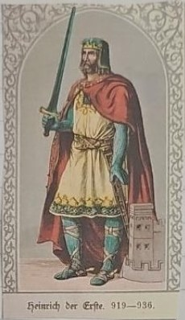
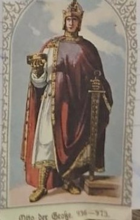
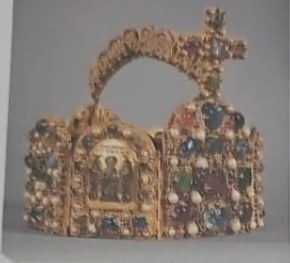
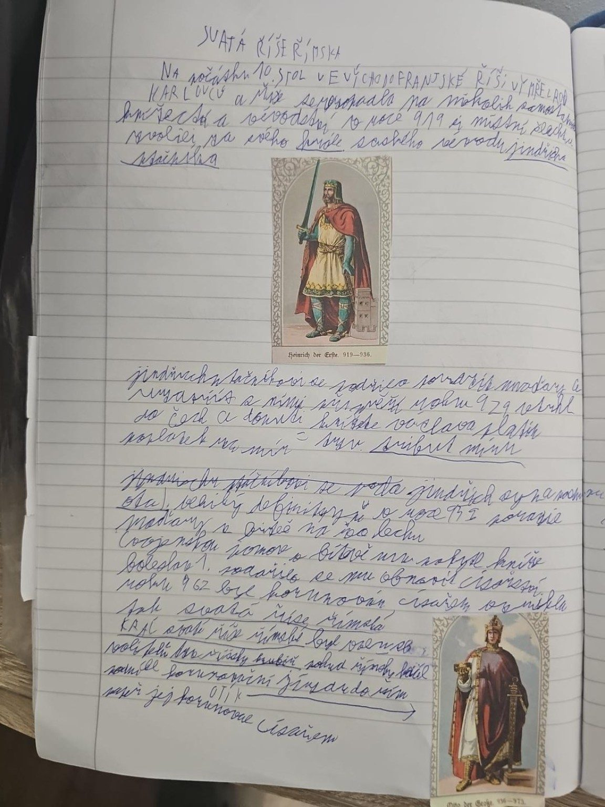
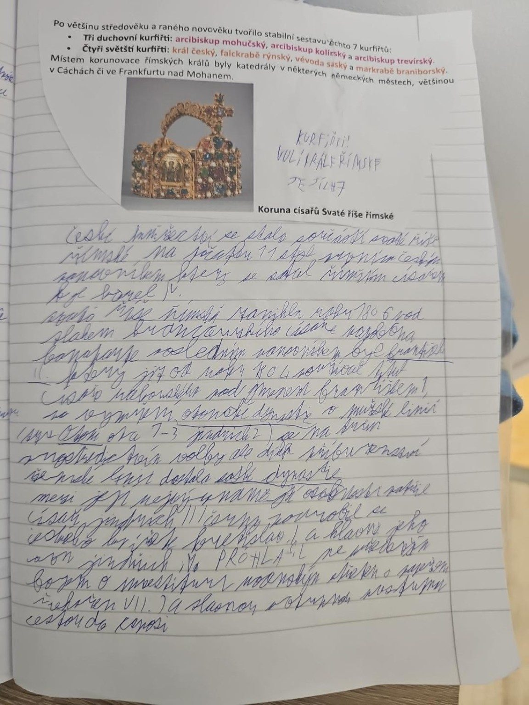

# Svatá říše římská

> **Ve zkratce:** Z východní části Franské říše vznikla roku 962 Svatá říše římská. České země k ní patřily, ale měly vlastní panovníky a od roku 1212 dědičné krále.

## Vznik říše

Po rozdělení Franské říše roku **843** se její východní část vyvíjela jako **Východofranská říše**. V 10. století se zde prosadili panovníci z **Otonské (Liudolfovské) dynastie**.

- **Jindřich I. Ptáčník (919–936)** upevnil královskou moc a bojoval s Maďary i slovanskými sousedy.
- Jeho syn **Ota I. Veliký** se stal králem roku **936**.
- Roku **955** zvítězil Ota I. nad Maďary v **bitvě na řece Lechu**.
- Roku **962** byl Ota I. v Římě korunován **císařem**. Tento rok je tradičním mezníkem vzniku **Svaté říše římské**.

## České země a říše

České knížectví bylo s římskoněmeckými panovníky provázáno politicky i mocensky, zároveň mělo vlastní vládnoucí dynastii a velkou míru vnitřní autonomie. **Vratislav II.** získal roku **1085** královský titul (korunován **1086**), ale jen pro svou osobu. **Roku 1212** potvrdila **Zlatá bula sicilská** dědičný český královský titul.

## Kdo byli kurfiřti?

**Kurfiřti** byli říšští knížata oprávněná volit **římského krále**. Tradičních **sedm kurfiřtů** tvořili tři duchovní a čtyři světští:

| Duchovní | Světští |
|---|---|
| Arcibiskup mohučský | Český král |
| Arcibiskup kolínský | Falckrabě rýnský |
| Arcibiskup trevírský | Vévoda saský |
|  | Markrabě braniborský |

Pravidla volby kodifikovala **Zlatá bula Karla IV. z roku 1356**. Je třeba rozlišovat **volbu římského krále** a **císařskou korunovaci**: ve středověku to nebylo automaticky totéž.

## Dynastie a spor o investituru

Po Otonech vládla v říši nová panovnická rodina, **Sálovci**. Jeden z nich, císař **Jindřich IV.**, se přel s papežem o to, **kdo bude vybírat biskupy**. Tomu se říká **spor o investituru**. Biskupové totiž neměli na starosti jen víru, ale vlastnili i půdu, peníze a vojáky – kdo je vybíral, měl velkou moc.

**Zapamatuj si:** Císař a papež se hádali, kdo bude vybírat biskupy, protože biskupové měli velkou moc a majetek.

Po Sálovcích vládla další rodina, **Štaufové**. Nejznámější z nich byl **Fridrich I. Barbarossa**.

### Pro zajímavost

- **Kdo s kým:** císař Jindřich IV. proti papeži Řehořovi VII.
- **Proč to císař chtěl:** potřeboval, aby biskupové byli jeho lidé a poslouchali ho.
- **Proč to papež nechtěl:** chtěl, aby si biskupy vybírala sama církev, a ne císař.
- **Klatba:** papež vyloučil císaře z církve. Šlechtici pak přestali císaře poslouchat.
- **Canossa (1077):** císař musel ustoupit. Šel za papežem na hrad Canossa a tři dny stál bos ve sněhu, dokud mu papež neodpustil. Proto se dodnes říká *„jít do Canossy“*, když se někdo musí ponížit a omluvit.
- **Jak to dopadlo (1122):** ve **Wormském konkordátu** se dohodli napůl – biskupa vybírá církev, ale půdu mu dává císař.
- **Barbarossa** znamená „Rudovous“ – měl zrzavé vousy.

## Paměťový obraz

- **Řeka, koruna a sedm voličů:** Ota I. poráží Maďary na Lechu roku 955, získává císařskou korunu roku 962; později sedm kurfiřtů volí římského krále.

### Pozor na častou chybu

**Sedm kurfiřtů v pevně kodifikované podobě patří až do 14. století**. Nejde o součást založení říše roku 962. A kurfiřti primárně volili **římského krále**, nikoliv vždy přímo císaře.

## Zápis ze sešitu

Fotky stránek sešitu

