# Svatá říše římská

> **Ve zkratce:** Z východní části Franské říše vznikla roku 962 Svatá říše římská, když byl Ota I. korunován císařem. Krále volili kurfiřti, české knížectví bylo součástí říše. Říše zanikla až roku 1806 pod tlakem Napoleona.

## Vznik říše

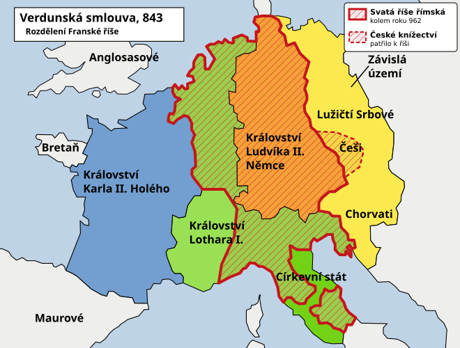

Mapa: [Wikimedia Commons](https://commons.wikimedia.org/wiki/File:Treaty_of_Verdun_cs.svg) – Christoph S., Wolpertinger, AdolfPorn, licence [CC BY-SA 3.0](https://creativecommons.org/licenses/by-sa/3.0/); doplněno vyznačení Svaté říše římské.

Všechny barevné části mapy dohromady tvořily **Franskou říši** Karla Velikého. Roku **843** si ji jeho tři vnuci rozdělili:

- **modrá – západ:** Karel Holý → z toho později **Francie**,
- **zelená – střed:** Lothar I. → pás od Severního moře do Itálie,
- **oranžová – východ:** Ludvík Němec → **Východofranská říše**, z ní později vznikla **Svatá říše římská** (dnešní Německo).

Žlutá území (i **Češi**) nepatřila přímo do říše, ale byla na Francích závislá.

**Červeně** je vyznačena **Svatá říše římská** kolem roku **962**: celý východní díl (Ludvík Němec), k tomu sever Lotharova dílu (**Lotrinsko**) a **severní Itálie**. Patřilo k ní i **České knížectví** (čárkovaně).

## Jindřich I. Ptáčník

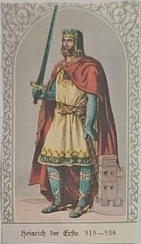

Na počátku **10. století** ve **Východofranské říši** **vymřel rod Karlovců**. Říše se pak **rozpadla na několik samostatných knížectví a vévodství**: každý kraj měl svého vévodu a nikdo nad nimi nevládl.

Roku **919** si místní šlechta zvolila za svého <mark>krále</mark> saského vévodu <mark>Jindřicha Ptáčníka</mark>. **Proč je to důležité:** král už nebyl Karlovec, ale **zvolený** šlechtou. Volba krále pak v říši zůstala natrvalo (viz kurfiřti níže).

Jindřichovi se podařilo **porazit Maďary** a **uzavřít s nimi příměří**. Roku **929** **vtrhl do Čech** a donutil knížete **Václava** (svatého Václava) platit **poplatek za mír**, tzv. <mark>tribut míru</mark>. Václav tedy každý rok platil, a Jindřich za to Čechy nenapadal. **Proč je to důležité:** od té doby byly Čechy na říši **závislé**.

## Ota I. Veliký a vznik Svaté říše římské

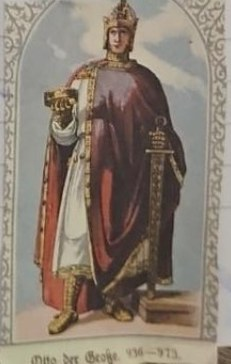

Po otci Jindřichovi nastoupil na trůn <mark>Ota I.</mark> **Veliký**. Roku **955** **definitivně porazil Maďary** v **bitvě na řece Lechu**. **Vojenskou pomoc** mu v bitvě poskytl český kníže **Boleslav I.** Po této porážce Maďaři s nájezdy přestali (téma Uherské království).

Otovi se podařilo **obnovit císařství**: navázal na Karla Velikého, který byl korunován císařem roku 800. Roku **962** byl Ota **korunován císařem**, a tak vznikla <mark>Svatá říše římská</mark>. *Římská* proto, že měla navazovat na starou Římskou říši, a *svatá*, protože císaře korunoval papež.

## Kurfiřti: kdo volil krále

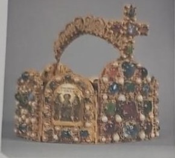

<mark>Král Svaté říše římské</mark> se nedědil, ale byl **volen**. Volili ho <mark>říšští kurfiřti</mark> (*kurfiřt* = kníže volitel). <mark>Kurfiřti volí římského krále a je jich 7</mark>: tři duchovní a čtyři světští.

| Duchovní | Světští |
|---|---|
| Arcibiskup mohučský | Král český |
| Arcibiskup kolínský | Falckrabě rýnský |
| Arcibiskup trevírský | Vévoda saský |
|  | Markrabě braniborský |

**Proč je to důležité:** **český král** byl jedním ze sedmi kurfiřtů, a měl tedy v říši velký vliv.

<mark>Korunování</mark> mělo **dva kroky**:

1. Zvolený **římský král** byl korunován v některé německé katedrále, většinou v **Cáchách** nebo ve **Frankfurtu nad Mohanem**.
2. Pak jel do **Říma**, kde ho **korunovali císařem**.

Pravidla volby kodifikovala **Zlatá bula Karla IV. z roku 1356**.

## České země a říše

**České knížectví** se stalo **součástí Svaté říše římské** na počátku **11. století**. Mělo ale vlastní panovníky z rodu Přemyslovců.

**Prvním českým panovníkem, který se stal římským císařem, byl Karel IV.**

Prvním českým králem byl **Vratislav II.** (1085, viz níže), ale jen pro sebe. Souvislost: **roku 1212** potvrdila **Zlatá bula sicilská** českým panovníkům **dědičný královský titul**.

## Otoni a Sálovci

Rod <mark>Oty</mark> I. se nazývá <mark>otonská dynastie</mark>. Po Otovi vládli jeho potomci: **Ota II.**, **Ota III.** a **Jindřich II.** Pak otonská dynastie **vymřela v mužské linii** (nezůstal žádný syn).

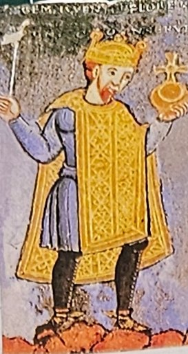
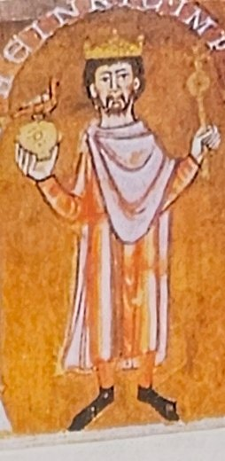

Na trůn se pak dostala <mark>sálská dynastie</mark>. Byla to **volba**, ale zvolili Sálovce **díky příbuzenství v ženské linii**: byli s Otony příbuzní přes ženy.

- Císař **Jindřich III. Černý** se utkal s českým knížetem **Břetislavem I.**
- Jeho syn **Jindřich IV.** se proslavil hlavně **bojem o investituru** s papežem **Řehořem VII.** a slavnou **pokornou cestou do Canossy**.

**Boj o investituru** byl spor, **kdo bude vybírat biskupy**: císař, nebo papež? Biskupové totiž neměli na starosti jen víru, ale vlastnili i půdu, peníze a vojáky. Kdo je vybíral, měl velkou moc. Papež dal císaře do **klatby** (vyloučil ho z církve) a šlechtici ho přestali poslouchat. Jindřich IV. proto musel ustoupit a roku **1077** jít za papežem na hrad **Canossa** prosit o odpuštění. Proto se cestě říká **pokorná**: mocný císař se musel před papežem ponížit.

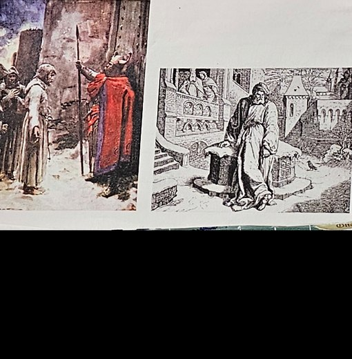

### Pro zajímavost

- **Dobrovolný úkol ze sešitu:** zjistit podrobnosti o cestě do Canossy a nakreslit k ní obrázek.
- **Cesta v zimě:** Jindřich IV. šel za papežem v zimě přes zasněžené Alpy do severní Itálie, kde byl papež na hradě Canossa.
- **Tři dny ve sněhu:** před bránou hradu stál tři dny bos, v prostém kajícném rouchu, a prosil o odpuštění. Teprve pak ho papež Řehoř VII. pustil dovnitř a klatbu zrušil.
- **„Jít do Canossy“:** dodnes se tak říká, když se někdo musí ponížit a omluvit.

## Vratislav II. a Kodex vyšehradský

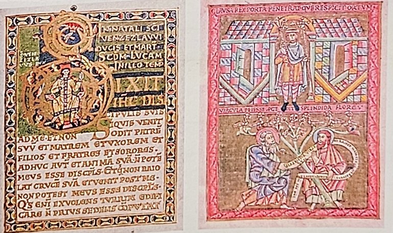

**Pro naše dějiny je klíčový** rok <mark>1085</mark>. Tehdy udělil císař Jindřich IV. českému knížeti <mark>Vratislavovi II.</mark> <mark>první český královský titul</mark>. Titul byl ale **pouze pro jeho osobu**, **nebyl dědičný**: jeho syn už byl zase jen kníže.

**Proč je to důležité:** Vratislav II. byl **první český král**. Ukázalo se, že český panovník je v říši tak důležitý, že si královskou korunu zaslouží.

U příležitosti jeho **korunovace** na **Pražském hradě** roku **1086** vznikl <mark>Kodex vyšehradský</mark>. Je to ručně psaná a bohatě zdobená kniha s texty evangelií a obrázky. Patří k **nejcennějším knihám** v Česku.

## Zánik říše

Svatá říše římská **zanikla roku 1806** pod tlakem francouzského císaře **Napoleona Bonaparta**. Trvala tedy přes **800 let** (962–1806).

Posledním panovníkem byl <mark>František II.</mark> Už od roku **1804** používal i titul **císaře rakouského** pod jménem **František I.** **Proč:** věděl, že Svatá říše římská může zaniknout, a chtěl zůstat císařem i potom. Proto má dvě čísla: v Svaté říši římské byl Druhý, v Rakousku První.

## Zapamatuj si

**919 Jindřich Ptáčník zvolen králem → 929 Václav platí tribut míru → 955 Ota I. poráží Maďary na Lechu (s pomocí Boleslava I.) → 962 Ota I. císařem = Svatá říše římská → krále volí 7 kurfiřtů, císařem ho korunují v Římě → Otoni → Sálovci (Jindřich IV., investitura, 1077 Canossa) → 1085 Vratislav II. první český král (jen pro sebe), 1086 Kodex vyšehradský → 1806 zánik pod tlakem Napoleona, poslední František II.**

## Paměťový obraz

- **Ptáčník u sítě:** Jindřich zvolený šlechtou roku 919.
- **Václav s měšcem:** roku 929 platí Jindřichovi tribut míru.
- **Řeka, koruna a sedm voličů:** Ota I. a Boleslav I. porážejí Maďary na Lechu 955, Ota získává císařskou korunu 962; sedm kurfiřtů volí římského krále.
- **Bosý císař ve sněhu:** Jindřich IV. jde do Canossy za papežem Řehořem VII.
- **Král s knihou:** Vratislav II. si roku 1085 nasadí korunu, v ruce drží zdobený Kodex vyšehradský (1086).
- **Napoleon zhasíná svíčku:** 1806 konec říše, František II. si nasadí rakouskou korunu jako František I.

### Pozor na častou chybu

**Římský král** a **císař** nejsou totéž: kurfiřti volili krále, císařem se stal až korunovací v Římě. **Sedm kurfiřtů v pevně kodifikované podobě patří až do 14. století**, ne k založení říše roku 962.

## Zápis ze sešitu

Fotky stránek sešitu

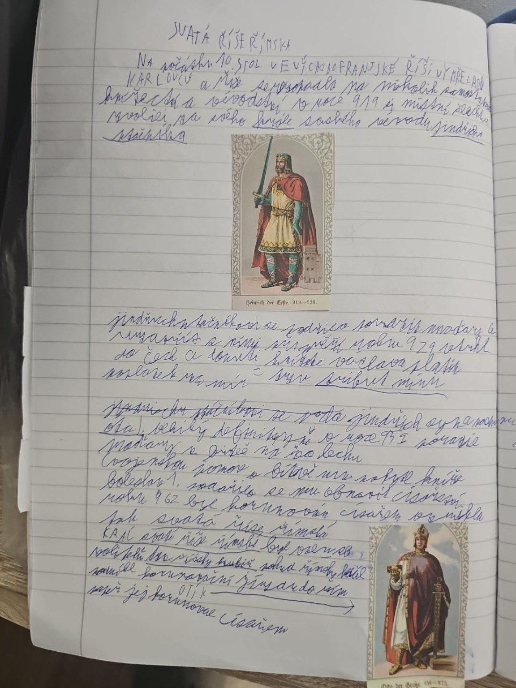

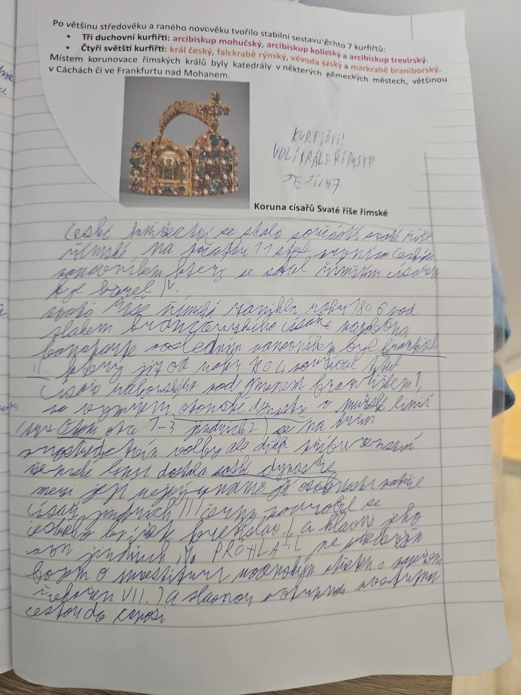

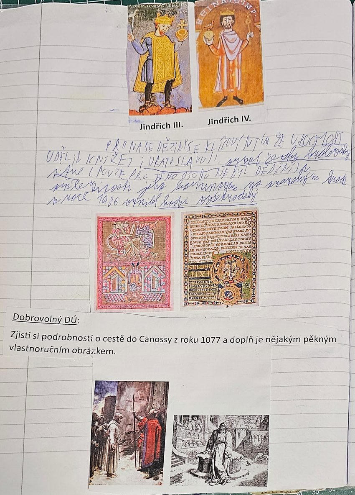

