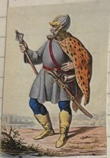
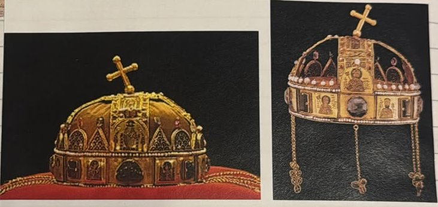
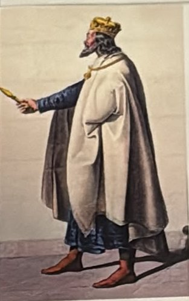
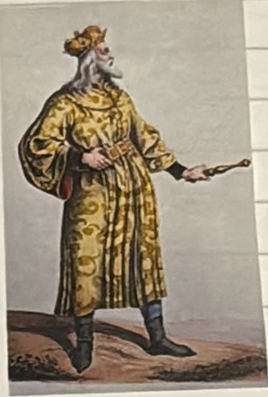
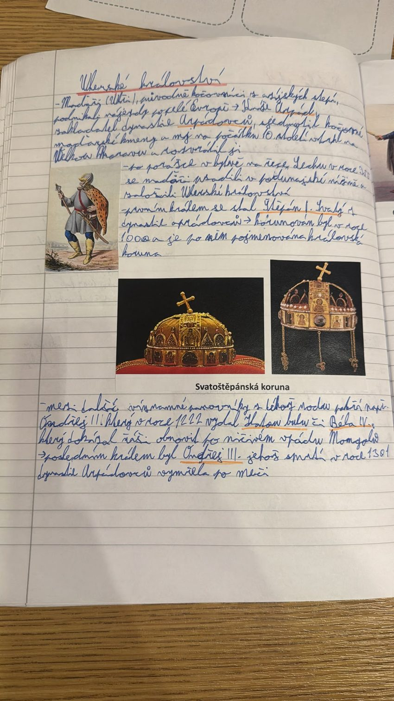
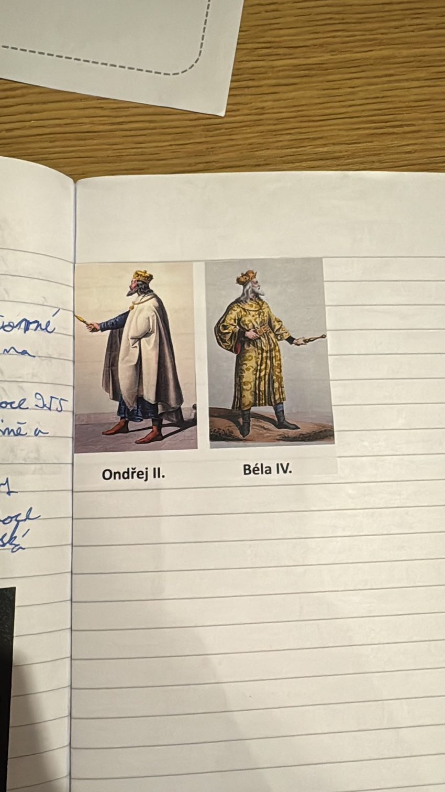

# Uherské království

> **Ve zkratce:** Maďaři přišli jako kočovníci z asijských stepí a rozvrátili Velkou Moravu. Po porážce na Lechu roku 955 se usadili v Podunajské nížině. Roku 1000 byl korunován první uherský král Štěpán I. Svatý z rodu Arpádovců, který vymřel roku 1301.

## Maďaři: kočovníci z asijských stepí

**Maďaři** (česky také **Uhři**) byli původně **kočovníci z asijských stepí**. Kočovníci nemají stálé domovy, putují se stády z místa na místo. Maďaři podnikali **nájezdy po celé Evropě**: přepadli kraj, vyloupili ho a odjeli.

Kníže **Arpád**, zakladatel dynastie **Arpádovců**, **sjednotil** kočovné maďarské kmeny. Na počátku **10. století** Maďaři vtrhli na **Velkou Moravu** a **rozvrátili ji**.

**Proč je to důležité:** Maďaři zničili **Velkou Moravu**, první velký stát západních Slovanů. Od té doby byli přímými sousedy Čechů.

## Vznik Uherského království

Roku **955** byli Maďaři poraženi v **bitvě na řece Lechu**. Porazil je **Ota I.**, pozdější první císař Svaté říše římské (téma Svatá říše římská). Po porážce se Maďaři **usadili v Podunajské nížině**, v rovinách kolem řeky Dunaje, a založili **Uherské království**.

**Proč je to důležité:** bitva na Lechu **ukončila maďarské nájezdy** na Evropu. Z kočovníků se stali usedlí lidé se svým vlastním státem.

**Prvním králem** se stal **Štěpán I. Svatý** z dynastie Arpádovců. Korunován byl roku **1000**. Přídomek *Svatý* má proto, že ho církev později prohlásila za svatého.

Po Štěpánovi je pojmenována **uherská královská koruna**, **Svatoštěpánská koruna**. Byla to nejdůležitější památka a symbol Uherského království.

## Další Arpádovci

- **Ondřej II.** vydal roku **1222** **Zlatou bulu**. Bula je důležitá listina se zlatou pečetí.
- **Béla IV.** dokázal **obnovit říši po ničivém vpádu Mongolů**. Mongolové byli kočovníci z Asie, kteří Uhry vyplenili. Béla zemi znovu postavil na nohy.
- **Posledním králem** z rodu byl **Ondřej III.** Jeho smrtí roku **1301** dynastie Arpádovců **vymřela po meči**. *Po meči* znamená, že nezůstal žádný syn ani jiný mužský potomek, který by mohl vládnout.

## Zapamatuj si

**Kočovníci z Asie → Arpád sjednotil kmeny, rozvrátili Velkou Moravu → 955 porážka na Lechu, usadili se v Podunají → 1000 Štěpán I. Svatý prvním králem (Svatoštěpánská koruna) → 1222 Zlatá bula Ondřeje II. → Béla IV. obnovil zemi po Mongolech → 1301 Arpádovci vymřeli po meči.**

## Paměťový obraz

- **Jezdec na stepi:** Maďaři kočovníci, Arpád, konec Velké Moravy.
- **Jezdec spadne do řeky Lech:** 955, Maďaři sesedají z koní a usadí se v Podunajské nížině.
- **Koruna se jménem krále:** Štěpán I. Svatý, rok 1000.
- **Zlatá pečeť:** Ondřej II., Zlatá bula 1222.
- **Zlomený meč:** 1301, Arpádovci vymřeli po meči.

### Pozor na častou chybu

Neplést si **tři zlaté buly**: **1212 Zlatá bula sicilská** (dědičný královský titul pro Čechy), **1222 Zlatá bula** Ondřeje II. (Uhry) a **1356 Zlatá bula Karla IV.** (volba římského krále).

## Zápis ze sešitu

Fotky stránek sešitu

