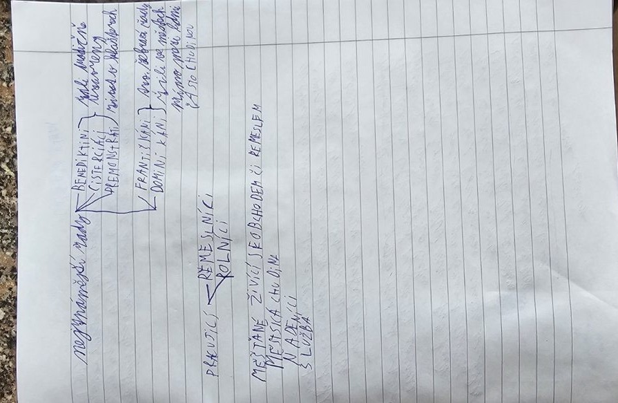

# Velké schizma – 1054

## Co znamená schizma?

**Schizma** znamená rozkol nebo rozdělení. Východní a západní část křesťanského světa se po staletí odlišovaly zvyky, jazykem bohoslužeb a názorem na autoritu papeže.

**Roku 1054** došlo k výraznému sporu mezi představiteli Říma a Konstantinopole. Datum se tradičně uvádí jako symbol rozdělení mezi **římskokatolickou (západní)** a **pravoslavnou (východní)** církev. Rozdělení bylo **dlouhodobý proces**, ne okamžitá změna všech komunit v jediném roce.

| Západ | Východ |
|---|---|
| Řím | Konstantinopol |
| Papež | Patriarchové, včetně konstantinopolského |
| Historicky převládala latina | Historicky významná byla řečtina |
| Katolická tradice | Pravoslavná tradice |

### Zapamatuj si

**1054 – jeden křesťanský svět se postupně rozděluje na západní a východní církev.**

## Zápis ze sešitu

Fotky stránek sešitu

