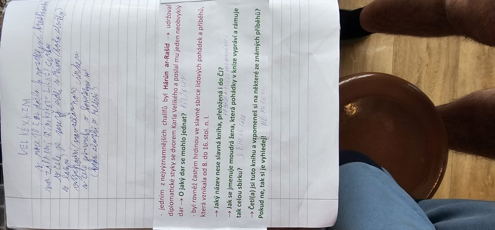

# Velké schizma – 1054

> **Ve zkratce:** Roku 1054 se křesťanství rozdělilo na západní, římskokatolickou církev s papežem v Římě, a východní, pravoslavnou církev s patriarchou v Konstantinopoli.

## Co znamená schizma?

**Schizma** znamená **rozkol**, rozdělení. V roce **1054** došlo k rozdělení křesťanství na dvě církve:

| Západní církev | Východní církev |
|---|---|
| **římskokatolická** | **pravoslavná** |
| v čele **papež** | v čele **patriarcha** |
| sídlí v **Římě** | sídlí v **Konstantinopoli** |
| bohoslužby v **latině** | bohoslužby v **řečtině** |

**Proč je to důležité:** obě církve existují **dodnes**. Na západě Evropy (i u nás) převládli katolíci, na východě pravoslavní.

Souvislost: Konstantinopol byla hlavním městem **Byzantské říše** (téma Byzantská říše).

## Zapamatuj si

**1054: křesťanství se rozdělilo → západ = římskokatolická církev, papež, Řím, latina → východ = pravoslavná církev, patriarcha, Konstantinopol, řečtina.**

## Paměťový obraz

- **Dvě poloviny kostela:** v levé papež v Římě čte latinsky, v pravé patriarcha v Konstantinopoli řecky; mezi nimi trhlina s číslem 1054.

### Ověření proti zápiskům

Rok 1054 je **symbolický**. Spory mezi Římem a Konstantinopolí trvaly už dlouho předtím a rozdělení bylo postupné.

## Zápis ze sešitu

Fotka stránky sešitu

