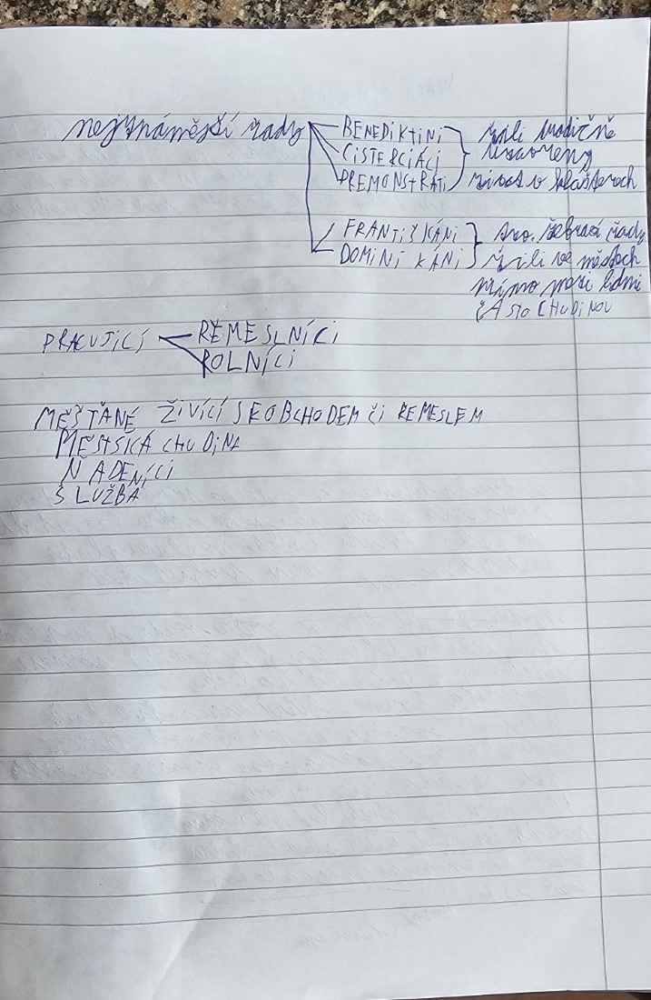

# Strana 1 – Středověká společnost (pokračování): řády, pracující, měšťané

Čitelná rekonstrukce rukopisu, ne doslovný OCR výstup. Navazuje na stranu 2.

> **Nejznámější řády:**
> - **benediktini, cisterciáci, premonstráti** → žili tradičně uzavřeni mimo svět v klášterech
> - **františkáni, dominikáni** → tzv. žebravé řády, žili ve městech přímo mezi lidmi, často s chudinou
>
> **Pracující** → řemeslníci, rolníci
>
> **Měšťané** živící se obchodem či řemeslem
> - městská chudina
> - nádeníci
> - služba

Poznámka: dřívější verze tohoto přepisu uváděla velké schizma a Přemyslovce. Na této fotce nic z toho není. Schizma je na straně 4.

Výklad: [Středověká společnost a církev](../../ucivo/stredoveka-spolecnost.md).
