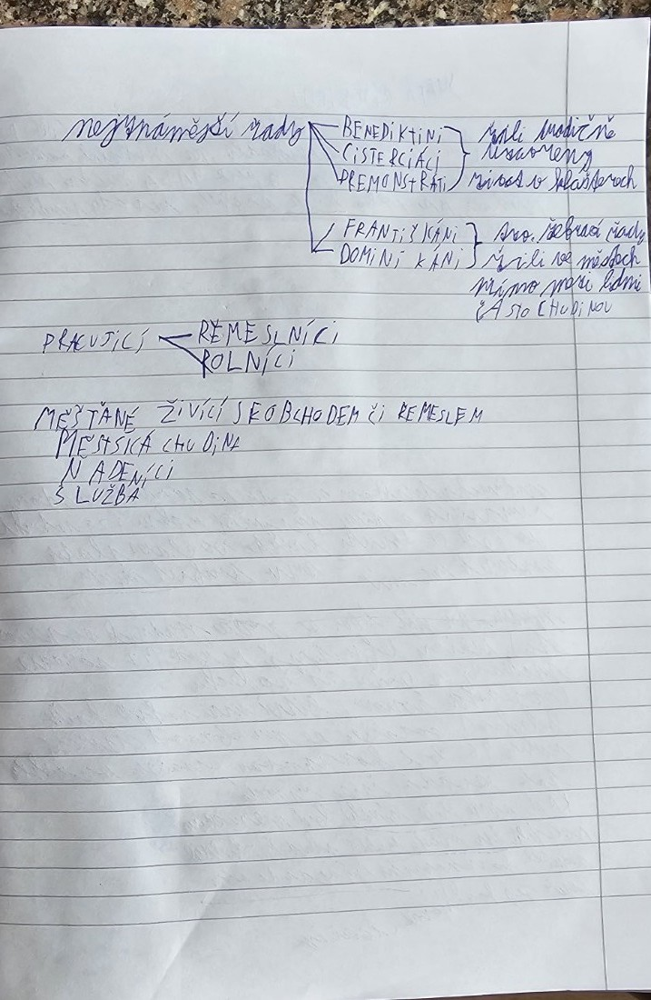

# Strana 1 – Velké schizma a počátky přemyslovského státu

## Rekonstrukce obsahu poznámek
- **Velké schizma** – rok **1054**; rozdělení křesťanství na západní (římskokatolickou) a východní (pravoslavnou) tradici. V zápiscích je zmíněna role Konstantinopole a Říma.
- **Přemyslovci** – v poznámkách je uveden původ českého panovnického rodu a následně začátky českého státu. V části rukopisu jsou odkazy na města, obchod a význam panovníka.
- **Měšťané** – obyvatelé měst; ve městech byli řemeslníci, obchodníci, nádeníci i služba.

## Vysvětlení / oprava
Rozkol křesťanství v roce 1054 nebyl jednorázovým úplným rozdělením, ale vyústěním dlouhodobých sporů. O přemyslovských knížatech je vhodné učit se v samostatné kapitole českých dějin.

> **Čitelnost:** Prostřední část rukopisného zápisu je na fotografii obtížně čitelná; tento soubor je věrná *tematická rekonstrukce*, nikoli doslovný přepis každého slova.
