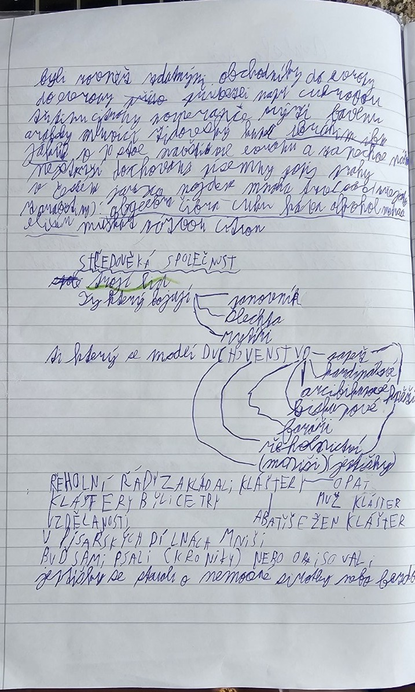

# Strana 2 – Středověká společnost a duchovenstvo

## Rekonstrukce obsahu poznámek
- Středověká společnost: **duchovenstvo, šlechta, poddaní**.
- Řeholní život: kláštery, mniši a jeptišky; modlitba a práce.
- **Benediktini, cisterciáci, premonstráti** – klášterní řády.
- **Františkáni a dominikáni** – žebravé řády, působení mezi lidmi a ve městech.
- V zápiscích jsou uvedeni duchovní a další obyvatelé měst; u společenských vrstev se liší postavení, majetek a povinnosti.

## Doplňující kontext
Kláštery uchovávaly knihy, opisovaly rukopisy, vzdělávaly a hospodařily. Rozdělení společnosti na tři stavy je myšlenkový model, nikoli úplný výčet všech povolání a skupin.
