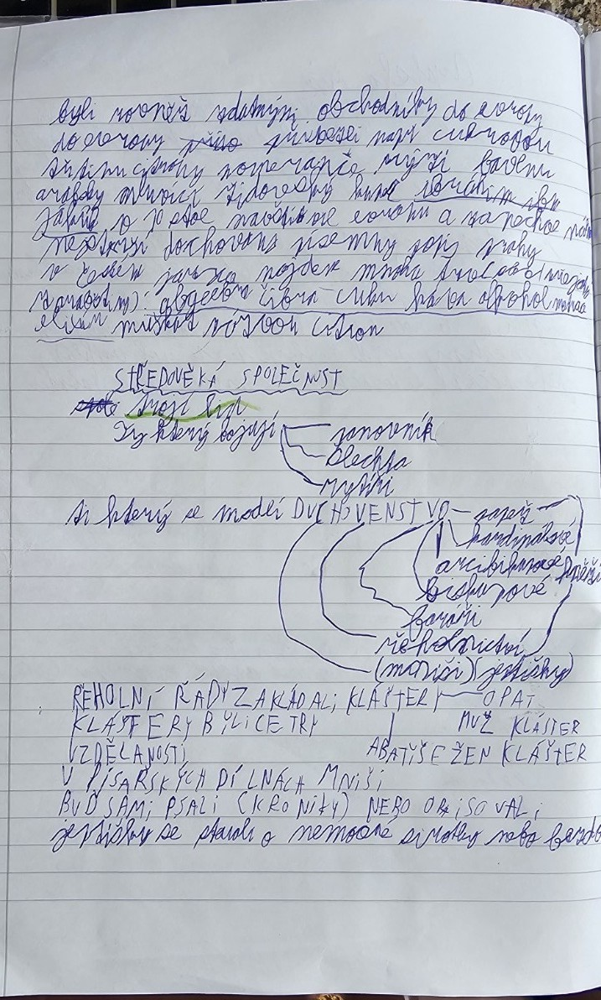

# Strana 2 – Arabové (dokončení); Středověká společnost

Čitelná rekonstrukce rukopisu, ne doslovný OCR výstup. Podtržené pasáže jsou **tučně**; nejisté čtení je označeno (?).

Dokončení arabské říše (navazuje na stranu 3):

> (Arabové) byli rovněž zdatnými obchodníky, do Evropy přivezli např. cukrovou třtinu, citrony, pomeranče, rýži, bavlnu.
>
> Arabsky mluvící židovský kupec **Ibráhím ibn Jákúb** v 10. století navštívil Evropu a zanechal nám nejstarší dochovaný písemný popis Prahy.
>
> V českém jazyce najdeme mnoho slov arabského původu: **algebra, číslo (cifra), cukr, káva, alkohol, matrace, elixír, muškát (?), sirup (?), citron**.

> **Středověká společnost**
>
> Tvoří ji **tři** skupiny:
> - **ti, kteří bojují** → panovník, šlechta, rytíři
> - **ti, kteří se modlí: duchovenstvo** → papež, kardinálové, arcibiskupové, biskupové, faráři (kněží), řeholníci (mniši), jeptišky
>
> Řeholní řády zakládaly kláštery → v čele mužského kláštera **opat**, ženského kláštera **abatyše**.
>
> Kláštery byly centry vzdělanosti. V písařských dílnách mniši buď sami psali (kroniky), nebo opisovali. Jeptišky se staraly o nemocné, sirotky nebo bezdomovce (?).

Pokračování je na straně 1. Výklad: [Středověká společnost a církev](../../ucivo/stredoveka-spolecnost.md), [Arabská říše a islám](../../ucivo/arabska-rise-a-islam.md).
