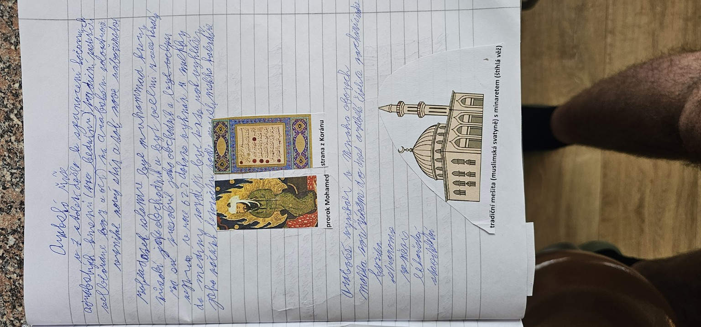

# Strana 3 – Arabská říše

Čitelná rekonstrukce rukopisu, ne doslovný OCR výstup. Podtržené pasáže jsou **tučně**, přeškrtnuté vynechány.

> **Arabská říše**
>
> V 7. století došlo ke sjednocení kočovných arabských kmenů (tzv. **beduínů**) – tradiční pastevci velbloudů, koz a ovcí. Na Arabském poloostrově vznikl nový stát a také nové náboženství.
>
> Zakladatelem islámu byl Muhammad, který působil jako obchodník a hodně cestoval. V roce 622 byl donucen odejít z Mekky do Medíny. Později byl tento rok vyhlášen jako počátek letopočtu podle muslimského kalendáře.

*Tištěné obrázky s popisky: prorok Mohamed; strana z Koránu.*

> Arabové vynikali v mnoha oborech:
> - matematika – používáme dodnes arabské číslice (převzali je z Indie)
> - fyzika
> - astronomie
> - zeměpis
> - lékařství
> - stavitelství

*Tištěný obrázek s popiskem: tradiční mešita (muslimská svatyně) s minaretem (štíhlá věž).*

Pokračování je na straně 2 nahoře (obchod, Ibráhím ibn Jákúb, arabská slova). Výklad: [Arabská říše a islám](../../ucivo/arabska-rise-a-islam.md).
