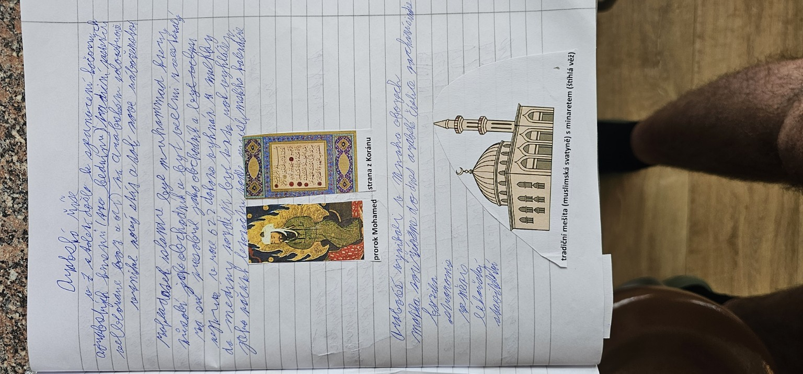

# Strana 3 – Arabský poloostrov, Mohamed a Korán

## Rekonstrukce obsahu poznámek
- **Arabský poloostrov**; Arabové žili v obchodních městech i jako kočovníci.
- **Mekka**, významné náboženské a obchodní město.
- **Mohamed (Muhammad)**, prorok islámu; začátek nového náboženství v 7. století.
- **Korán** – posvátná kniha islámu.
- **622** – odchod Mohameda z Mekky do **Medíny**, začátek muslimského letopočtu.
- Islám je **monoteistické** náboženství – víra v jednoho Boha.
- Mešita a minaret souvisejí s muslimským náboženským životem.

## Upřesnění
Rok 622 označuje hidžru; není to počátek Mohamedova působení. Korán se stal základem islámského náboženství. Islám se rozšířil také mimo arabské obyvatelstvo.
