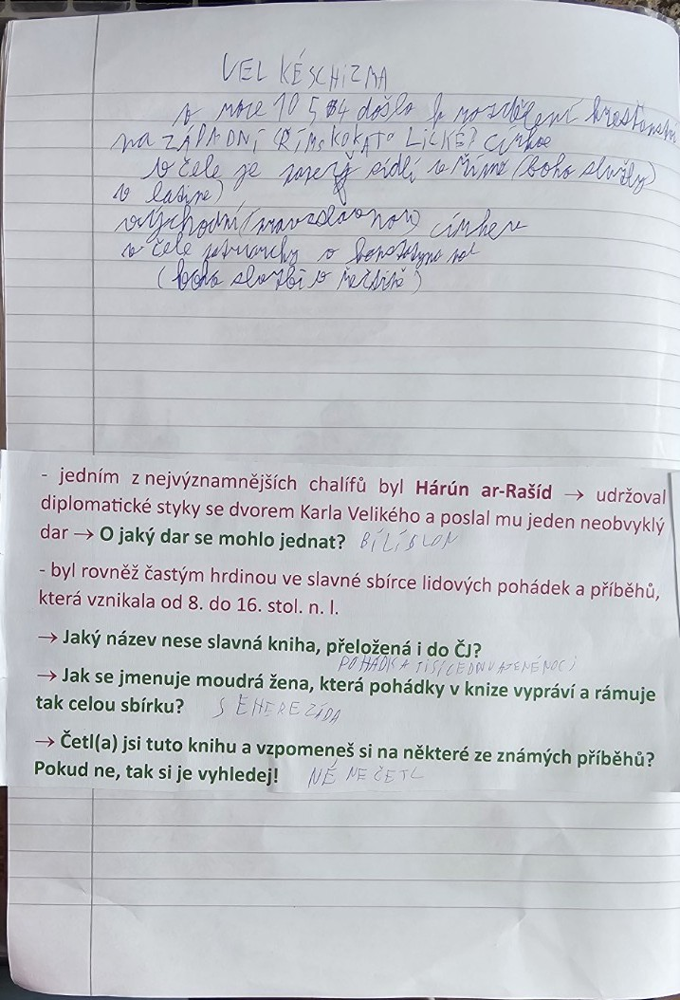

# Strana 4 – Velké schizma; Harún ar-Rašíd

Čitelná rekonstrukce rukopisu, ne doslovný OCR výstup.

> **Velké schizma**
>
> V roce 1054 došlo k rozdělení křesťanství na:
> - **západní (římskokatolickou) církev** – v čele je papež, sídlí v Římě (bohoslužby v latině)
> - **východní (pravoslavnou) církev** – v čele patriarcha v Konstantinopoli (bohoslužby v řečtině)

Tištěný pracovní list k arabské říši, s ručně doplněnými odpověďmi:

> - jedním z nejvýznamnějších chalífů byl **Hárún ar-Rašíd** → udržoval diplomatické styky se dvorem Karla Velikého a poslal mu jeden neobvyklý dar → **O jaký dar se mohlo jednat?** *bílý slon*
> - byl rovněž častým hrdinou ve slavné sbírce lidových pohádek a příběhů, která vznikala od 8. do 16. stol. n. l.
>
> → **Jaký název nese slavná kniha, přeložená i do ČJ?** *Pohádky tisíce a jedné noci*
>
> → **Jak se jmenuje moudrá žena, která pohádky v knize vypráví a rámuje tak celou sbírku?** *Šeherezáda*
>
> → **Četl(a) jsi tuto knihu a vzpomeneš si na některé ze známých příběhů? Pokud ne, tak si je vyhledej!** *Ne, nečetl.*

Výklad: [Velké schizma](../../ucivo/velke-schizma.md), [Arabská říše a islám](../../ucivo/arabska-rise-a-islam.md).
