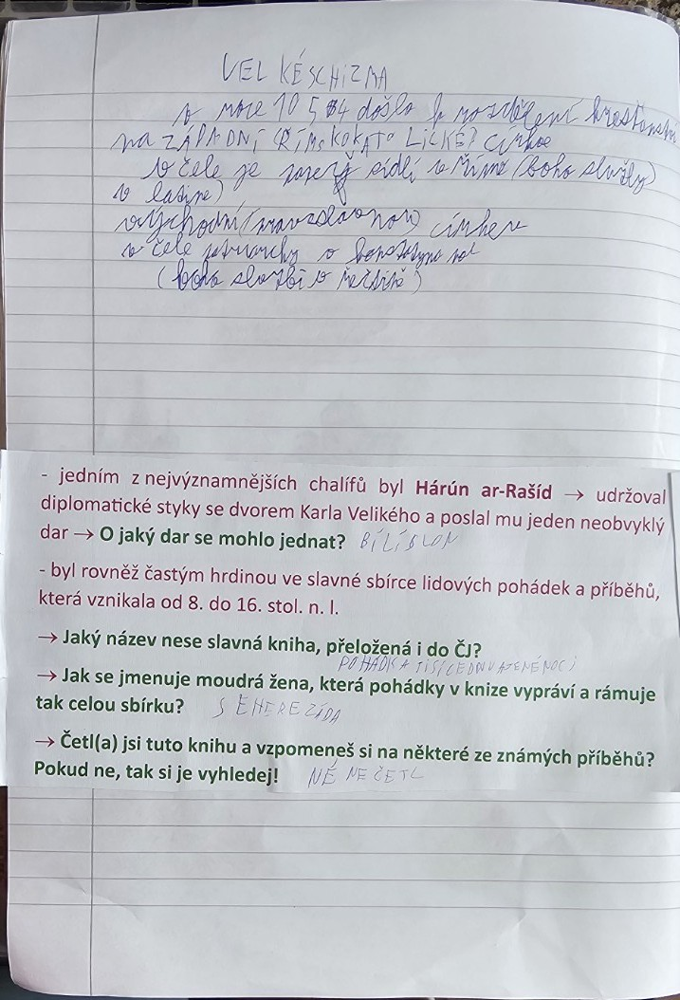

# Strana 4 – Arabská expanze a kultura

## Rekonstrukce obsahu poznámek
- Výboje Arabů a rozšíření muslimské říše po smrti Mohameda.
- **Chalífa** – následovník Mohameda v čele muslimské obce.
- V zápiscích se připomíná pokrok v **medicíně, matematice, zeměpisu a astronomii**.
- Obchod a kulturní kontakty mezi islámským světem a Evropou.
- Zmíněn je **Harún ar-Rašíd**, Karel Veliký a příběhy **Tisíce a jedné noci**.

## Upřesnění
V roce **732** franské vojsko Karla Martela vyhrálo u Tours/Poitiers. **Harún ar-Rašíd** vládl 786–809 a prostřednictvím vyslanců poslal Karlu Velikému slona Abú al-Abbáse. Literární sbírka Tisíc a jedna noc vznikala postupně z různých příběhových tradic.
