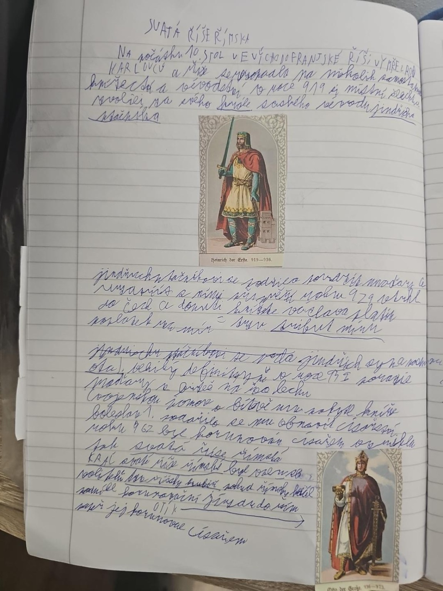

# Strana 5 – Svatá říše římská: počátky

## Přepis obsahových bodů
- **Svatá říše římská** navazovala na východní část Franské říše.
- **Jindřich I. Ptáčník (919–936)** – upevňování moci, boj s Maďary a slovanskými kmeny.
- **Ota I. Veliký (936–973)** – Jindřichův syn, po vítězství nad Maďary u řeky **Lechu roku 955** upevnil svou moc.
- **962** – Ota I. korunován císařem; tradiční datum vzniku Svaté říše římské.
- V poznámkách také české knížectví, jeho vztah k císaři a domácí panovnická moc.

## Historická poznámka
Termín Svatá říše římská se pro útvar založený v roce 962 používá zpětně; vlastní název se vyvíjel. České země si zachovávaly značnou vnitřní samostatnost.
