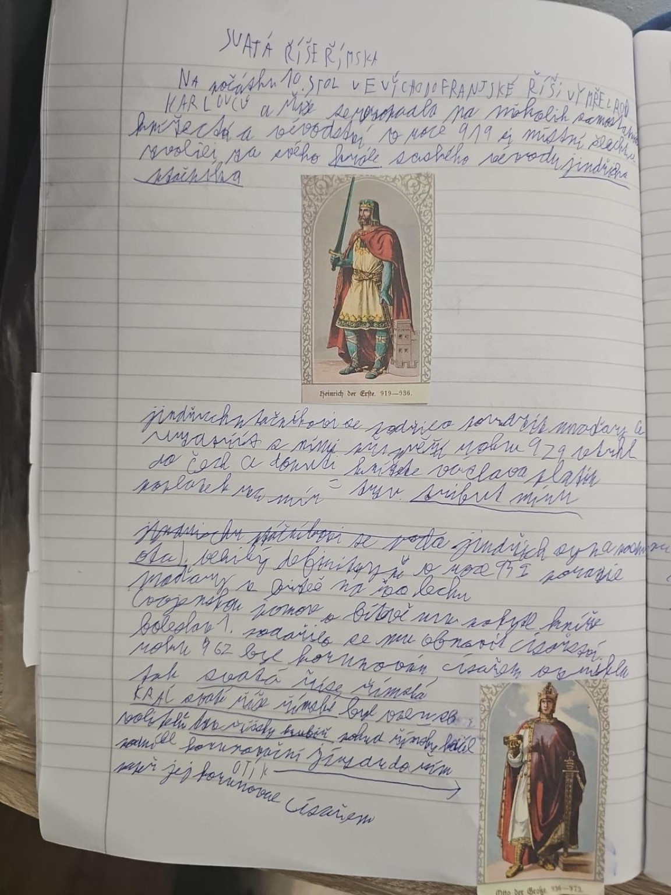

# Strana 5 – Svatá říše římská: počátky

Čitelná rekonstrukce rukopisu, ne doslovný OCR výstup. Podtržené pasáže jsou **tučně**, přeškrtnutý začátek věty je vynechán.

> **Svatá říše římská**
>
> Na počátku 10. stol. ve Východofranské říši vymřel rod Karlovců a říše se rozpadla na několik samostatných knížectví a vévodství. V roce 919 si místní šlechta zvolila za svého **krále** saského vévodu **Jindřicha Ptáčníka**.
>
> Jindřichu Ptáčníkovi se podařilo porazit Maďary a uzavřít s nimi příměří. Roku 929 vtrhl do Čech a donutil knížete Václava platit poplatek za mír = tzv. **tribut míru**.
>
> Po otci Jindřichovi nastoupil na trůn **Ota I.** Veliký, definitivně v roce 955 porazil Maďary v bitvě na řece Lechu (vojenskou pomoc v bitvě mu poskytl kníže Boleslav I.). Podařilo se mu obnovit císařství, roku 962 byl korunován císařem, vznikla tak **Svatá říše římská**.
>
> **Král Svaté říše římské** byl volen voliteli, tzv. **říšskými kurfiřty**, poté římský král na samotné **korunování** jezdil do Říma, kde jej korunovali císařem.

*Nalepené obrázky s tištěnými popisky: Heinrich der Erste 919–936 (Jindřich I.); Otto der Große 936–973 (Ota I. Veliký, šipka s popiskem „Otík“).*

Výklad: [Svatá říše římská](../../ucivo/svata-rise-rimska.md).
