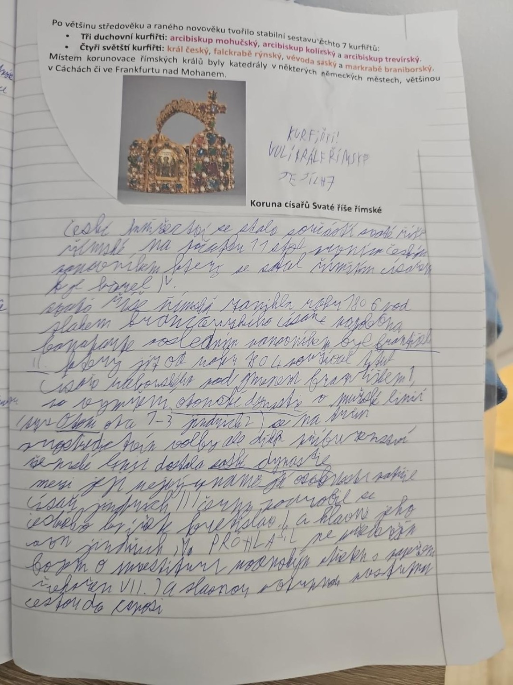

# Strana 6 – Kurfiřti, české knížectví, zánik říše, Sálovci

Čitelná rekonstrukce, ne doslovný OCR výstup. Podtržené pasáže jsou **tučně**.

Tištěný výstřižek:

> Po většinu středověku a raného novověku tvořilo stabilní sestavu těchto 7 kurfiřtů:
> - **Tři duchovní kurfiřti:** arcibiskup mohučský, arcibiskup kolínský a arcibiskup trevírský.
> - **Čtyři světští kurfiřti:** král český, falckrabě rýnský, vévoda saský a markrabě braniborský.
>
> Místem korunovace římských králů byly katedrály v některých německých městech, většinou v Cáchách či ve Frankfurtu nad Mohanem.

*Obrázek s popiskem: Koruna císařů Svaté říše římské.*

Rukopis vedle obrázku: **KURFIŘTI! Volí krále římského, je jich 7.**

Rukopis:

> České knížectví se stalo součástí Svaté říše římské na počátku 11. stol. Prvním českým panovníkem, který se stal římským císařem, byl Karel IV.
>
> Svatá říše římská zanikla roku 1806 pod tlakem francouzského císaře Napoleona Bonaparta. Posledním panovníkem byl **František II.**, který již od roku 1804 používal titul císaře rakouského pod jménem František I.
>
> Po vymření **otonské dynastie** v mužské linii (syn **Oty**: Ota II. – Ota III. – Jindřich II.) se na trůn prostřednictvím volby, ale díky příbuzenství v ženské linii dostala **sálská dynastie**. Mezi její nejvýznamnější osobnosti patřil císař Jindřich III. Černý, který se utkal s českým knížetem Břetislavem I., a hlavně jeho syn Jindřich IV., který se proslavil především bojem o investituru (mocenským střetem s papežem Řehořem VII.) a slavnou pokornou cestou do Canossy.

Poznámka: dřívější verze tohoto přepisu uváděla Vratislava II. (1085/1086), Vladislava II. (1158), Zlatou bulu sicilskou (1212), Zlatou bulu Karla IV. (1356) a Štaufy. Na této fotce nic z toho není.

Výklad: [Svatá říše římská](../../ucivo/svata-rise-rimska.md).
