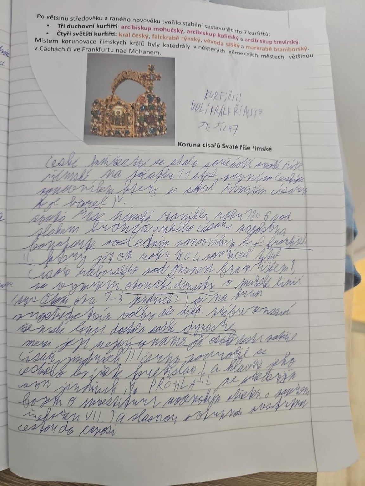

# Strana 6 – Český král, kurfiřti, dynastie a investitura

## Přepis obsahových bodů
- **České knížectví** bylo spojeno se Svatou říší římskou, ale mělo vlastní panovníky.
- **1085** – Vratislav II. získal královský titul; **1086** následovala korunovace. Titul nebyl dědičný.
- **1158** – královský titul získal také Vladislav II. (korunován v této době; titul opět nebyl dědičný).
- **1212 – Zlatá bula sicilská** potvrdila dědičný královský titul Přemyslovcům.
- **Kurfiřti** – knížata, která volila římského krále; **3 duchovní** (arcibiskupové mohučský, trevírský a kolínský) a **4 světští** (český král, falckrabě rýnský, vévoda saský, markrabě braniborský).
- **1356 – Zlatá bula Karla IV.** potvrdila pravidla volby.
- **Sálská dynastie**, **Jindřich IV.** a **boj o investituru** – spor panovníka a papeže o obsazování církevních úřadů.
- **Štaufové**, například **Fridrich I. Barbarossa**; po zániku vlády Štaufů říši oslabovaly vnitřní spory.

## Historické upřesnění
Kurfiřti volili především **římského krále**, jehož vztah k císařské koruně se během staletí vyvíjel. Sedmičlenný sbor a jeho pravomoci patří k pozdější historii říše, ne k roku 962.
