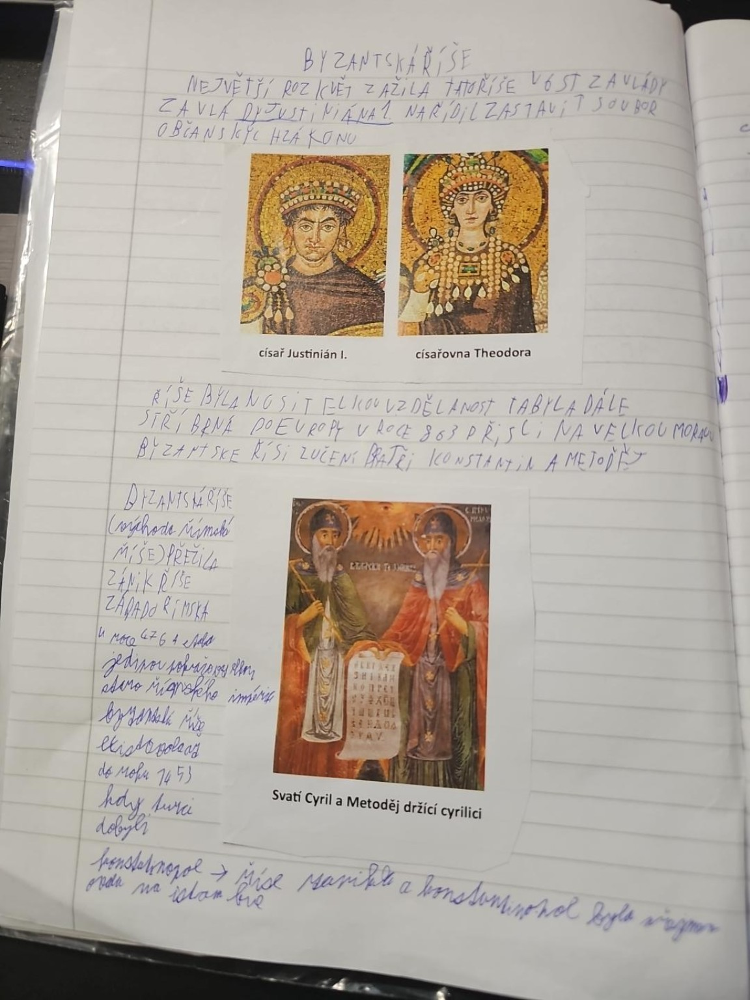

# Strana 7 – Byzantská říše

Přepis se zachováním smyslu, s upravenou interpunkcí. Poslední věta je špatně čitelná.

> Největší rozkvět zažila tato říše v 6. století za vlády Justiniána I. Nařídil sestavit soubor občanských zákonů.

*Tištěné obrázky: císař Justinián I.; císařovna Theodora.*

> Říše byla nositelkou vzdělanosti a ta byla dále šířena po Evropě. V roce 863 přišli na Velkou Moravu z Byzantské říše učení bratři Konstantin a Metoděj.

> Byzantská říše (Východořímská říše) přežila zánik Západořímské říše. V roce 476 se stala jedinou pokračovatelkou starořímského impéria. Byzantská říše existovala do roku 1453, kdy Turci dobyli Konstantinopol. [Říše zanikla a Konstantinopol byla přejmenována na Istanbul – poslední věta jen přibližně čitelná.]

*Popisek obrázku: „Svatí Cyril a Metoděj držící cyrilici.“ Tento popisek je historicky zavádějící: Konstantin vytvořil hlaholici.*

Opravy a vysvětlení: [Byzantská říše](../../ucivo/byzantska-rise.md).
