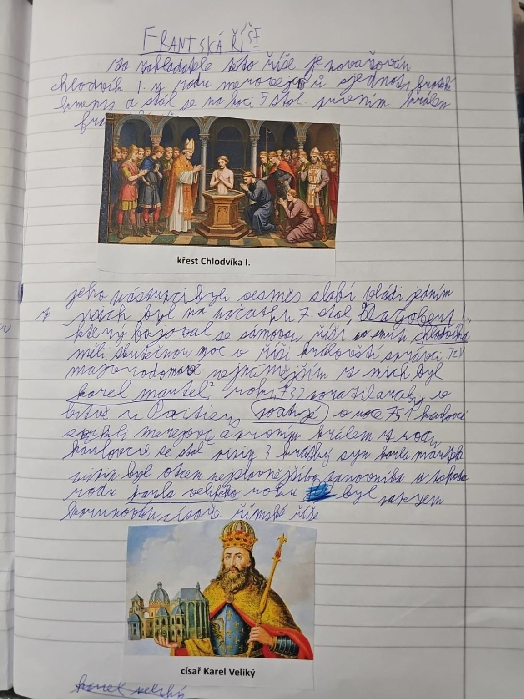

# Strana 8 – Franská říše

Fotografie zakrývá část horní věty. Následuje čitelná rekonstrukce, ne doslovný OCR výstup.

> [Za zakladatele Franské říše je považován] Chlodvík I. z rodu Merovejců. Sjednotil franské kmeny a stal se na konci 5. století prvním králem Franků.

*Tištěný popisek: křest Chlodvíka I.*

> Jeho nástupci byli vesměs slabí vládci. Jedním z nich byl na počátku 7. století Dagobert I., který bojoval se Sámovou říší v bitvě u Wogastisburgu. Skutečnou moc v říši drželi vojenští správci, tzv. majordomové. Nejznámějším z nich byl Karel Martel. Roku 732 porazil Araby v bitvě u Poitiers. V roce 751 se prvním králem z rodu Karlovců stal Pipin III. Krátký, syn Karla Martela. Pipin byl otcem nejznámějšího panovníka tohoto rodu, Karla Velikého. Roku 800 byl papežem korunován císařem římské říše.

*Tištěný popisek: císař Karel Veliký.*

Výklad a historické upřesnění: [Franská říše](../../ucivo/franska-rise.md).
