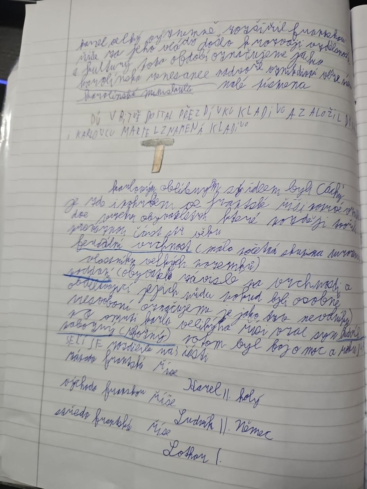

# Strana 9 – Franská říše: pokračování

Čitelná rekonstrukce rukopisu, ne doslovný OCR výstup. Podtržené pasáže jsou **tučně**.

> Karel Veliký významně rozšířil Franskou říši. Za jeho vlády došlo k rozvoji vzdělanosti a kultury. Toto období označujeme jako **karolinská renesance**. Zároveň vzniklo nové písmo – **karolinská minuskula**, malá písmena.

> (Karel Martel) v bitvě dostal přezdívku Kladivo a založil dynastii Karlovců. Martel znamená kladivo. *(nakreslené kladivo)*

> Karlovým oblíbeným sídlem byly Cáchy, je tam i pohřben.
>
> Ve Franské říši vznikly dvě skupiny obyvatelstva, které později tvořily převážnou část středověku:
> - **feudální vrchnost** (málo početná skupina mocných vlastníků velkých pozemků)
> - **poddaní** (obyvatelé závislí na vrchnosti a obdělávající její půdu; pokud byli osobně nesvobodní, označujeme je jako tzv. nevolníky)

> Po smrti Karla Velikého říši převzal syn **Ludvík Nábožný (Zbožný)**, potom byl boj o moc a říše se rozdělila na 3 části:

| Část v sešitě | Vnuk Karla Velikého |
|---|---|
| západofranská říše | Karel II. Holý |
| východofranská říše | Ludvík II. Němec |
| středofranská říše | Lothar I. |

Výklad: [Franská říše](../../ucivo/franska-rise.md).
