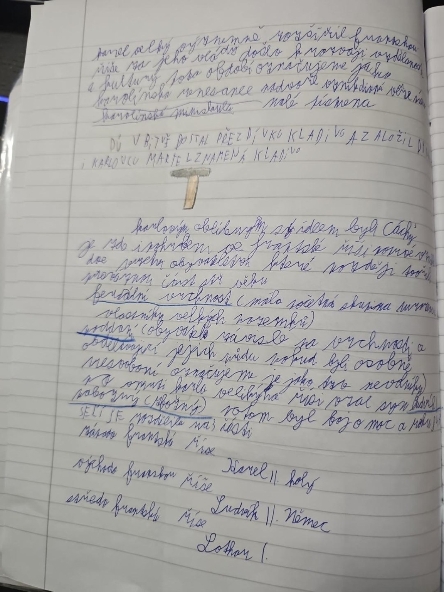

# Strana 9 – Franská říše: pokračování

Části na pravém okraji a uprostřed jsou nečitelné; zapisujeme je v hranatých závorkách. Náčrtek obsahuje i škrty a dodatečné poznámky.

> Karel Veliký významně rozšířil franskou říši. Za jeho vlády došlo k rozvoji vzdělanosti a kultury. Toto období označujeme jako karolinskou renesanci. Zároveň vzniklo nové písmo – karolinská minuskula, malá písmena.

> [Karel Martel] v bitvě dostal přezdívku Kladivo a [část nečitelná]. Martel znamená kladivo.

> Karlovým oblíbeným sídlem byly Cáchy. [Následuje méně čitelný odstavec o životě obyvatel a rozdělení společnosti.]

Čitelné pojmy v prostřední části: **feudální vrchnost**, **poddaní**, **nevolníci**, **nábožný (zbožný)**. Poznámky naznačují vlastnictví půdy vrchností a závislost poddaných; jednotlivé věty nejsou natolik jasné, aby se daly bezpečně vydávat za doslovný přepis.

> Po smrti Karla Velikého říši [převzal jeho syn Ludvík Pobožný]. Potom byl boj o moc a říše se rozdělila na tři části.

| Část v sešitě | Vnuk Karla Velikého |
|---|---|
| Západofranská říše | Karel II. Holý |
| Východofranská říše | Ludvík Němec |
| Středofranská říše | Lothar I. |

Studijní verze: [Franská říše](../../ucivo/franska-rise.md).
