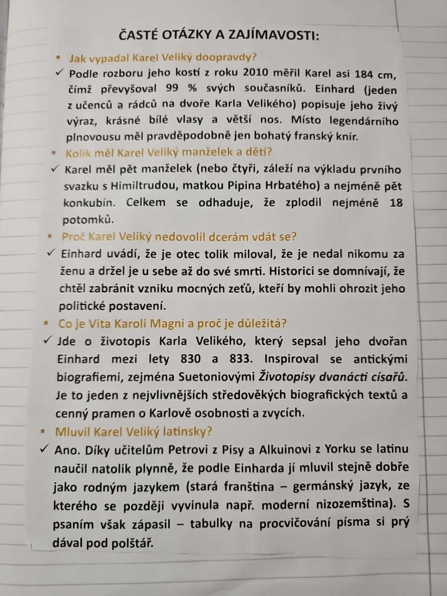

# Strana 10 – Časté otázky a zajímavosti o Karlu Velikém

Následuje přepis tištěného lístku na fotografii. Jeho tvrzení nejsou automaticky potvrzená historická fakta; studijní souvislosti jsou v [kapitole o Franské říši](../../ucivo/franska-rise.md).

**Jak vypadal Karel Veliký doopravdy?** Podle rozboru jeho kostí z roku 2010 měřil Karel asi 184 cm, čímž převyšoval 99 % svých současníků. Einhard (jeden z učenců a rádců na dvoře Karla Velikého) popisuje jeho živý výraz, krásné bílé vlasy a větší nos. Místo legendárního plnovousu měl pravděpodobně jen bohatý franský knír.

**Kolik měl Karel Veliký manželek a dětí?** Karel měl pět manželek (nebo čtyři, záleží na výkladu prvního svazku s Himiltrudou, matkou Pipina Hrbatého) a nejméně pět konkubín. Celkem se odhaduje, že zplodil nejméně 18 potomků.

**Proč Karel Veliký nedovolil dcerám vdát se?** Einhard uvádí, že je otec tolik miloval, že je nedal nikomu za ženu a držel je u sebe až do své smrti. Historici se domnívají, že chtěl zabránit vzniku mocných zeťů, kteří by mohli ohrozit jeho politické postavení.

**Co je Vita Karoli Magni a proč je důležitá?** Jde o životopis Karla Velikého, který sepsal jeho dvořan Einhard mezi lety 830 a 833. Inspiroval se antickými biografiemi, zejména Suetoniovými *Životopisy dvanácti císařů*. Je to jeden z nejvlivnějších středověkých biografických textů a cenný pramen o Karlově osobnosti a zvycích.

**Mluvil Karel Veliký latinsky?** Ano. Díky učitelům Petrovi z Pisy a Alkuinovi z Yorku se latinu naučil natolik plynně, že podle Einharda jí mluvil stejně dobře jako rodným jazykem (stará franština – germánský jazyk, ze kterého se později vyvinula např. moderní nizozemština). S psaním však zápasil – tabulky na procvičování písma si prý dával pod polštář.
