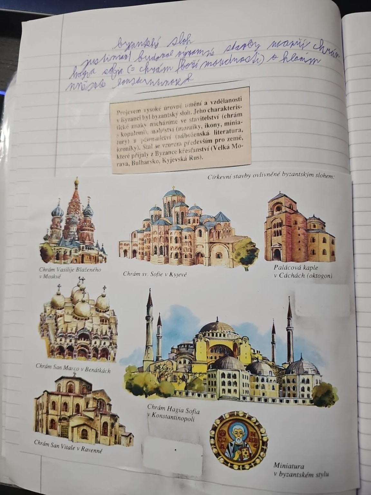

# Strana 11 – Byzantský sloh

Rukopis:

> Byzantský sloh. Justinián I. budoval významné stavby, například chrám Hagia Sofia (= chrám Boží moudrosti) v hlavním městě Konstantinopoli.

Tištěný výstřižek:

> Projevem vysoké úrovně umění a vzdělanosti v Byzanci byl byzantský sloh. Jeho charakteristické znaky nacházíme ve stavitelství (chrámy s kopulemi), malířství (mozaiky, ikony, miniatury) a písemnictví (náboženská literatura, kroniky). Stal se vzorem především pro země, které přijaly z Byzance křesťanství (Velká Morava, Bulharsko, Kyjevská Rus).

Popisky staveb: chrám Vasila Blaženého v Moskvě; chrám sv. Sofie v Kyjevě; palácová kaple v Cáchách (oktagon); chrám San Marco v Benátkách; chrám Hagia Sofia v Konstantinopoli; chrám San Vitale v Ravenně; miniatura v byzantském stylu.

Výklad: [Byzantská říše](../../ucivo/byzantska-rise.md).
