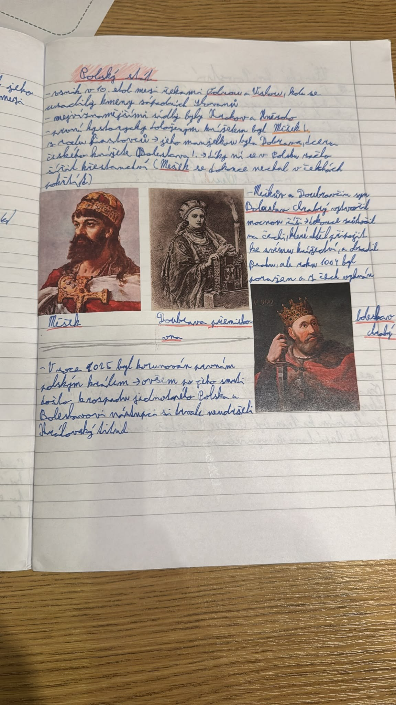

# Strana 12 – Polský stát

Čitelná rekonstrukce rukopisu, ne doslovný OCR výstup.

> **Polský stát**
>
> - vznik v 10. stol. mezi řekami Odrou a Vislou, kde se usadily kmeny západních Slovanů
> - nejvýznamnějšími sídly byly Krakov a Hnězdno
> - prvním historicky doloženým knížetem byl Měšek I. z rodu Piastovců → jeho manželkou byla Dobrava, dcera českého knížete Boleslava I. → díky ní se v Polsku začalo šířit křesťanství (Měšek se dokonce nechal v Čechách pokřtít)
> - Měškův a Doubravčin syn Boleslav Chrabrý vytvořil mocnou říši → dokonce zaútočil na Čechy, které chtěl připojit ke svému knížectví, a obsadil Prahu, ale roku 1004 byl poražen a z Čech vyhnán
> - V roce 1025 byl korunován prvním polským králem → ovšem po jeho smrti došlo k rozpadu jednotného Polska a Boleslavovi nástupci si trvale neudrželi královský titul

*Nalepené obrázky s popisky: Měšek; Doubrava Přemyslovna; Boleslav Chrabrý.*

Výklad a historické upřesnění: [Polský stát](../../ucivo/polsky-stat.md).
