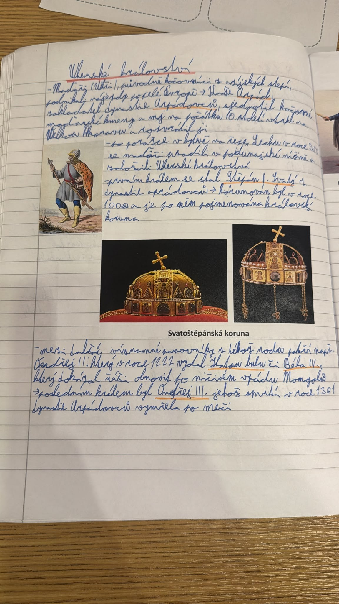

# Strana 13 – Uherské království

Čitelná rekonstrukce rukopisu, ne doslovný OCR výstup.

> **Uherské království**
>
> - Maďaři (Uhři), původně kočovníci z asijských stepí, podnikali nájezdy po celé Evropě → kníže Arpád, zakladatel dynastie Arpádovců, sjednotil kočovné maďarské kmeny a ty na počátku 10. století vtrhly na Velkou Moravu a rozvrátily ji
> - po porážce v bitvě na řece Lechu v roce 955 se Maďaři usadili v Podunajské nížině a založili Uherské království
> - prvním králem se stal Štěpán I. Svatý z dynastie Arpádovců → korunován byl v roce 1000 a je po něm pojmenována královská koruna
> - mezi další významné panovníky z tohoto rodu patří např. Ondřej II., který v roce 1222 vydal Zlatou bulu, či Béla IV., který dokázal říši obnovit po ničivém vpádu Mongolů → posledním králem byl Ondřej III., jehož smrtí v roce 1301 dynastie Arpádovců vymřela po meči

*Nalepené obrázky: maďarský bojovník (bez popisku); Svatoštěpánská koruna (tištěný popisek).*

Výklad a historické upřesnění: [Uherské království](../../ucivo/uherske-kralovstvi.md).
