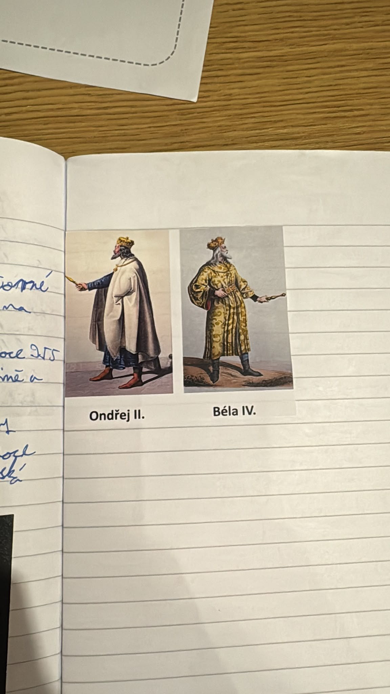

# Strana 14 – Ondřej II. a Béla IV.

Stránka obsahuje jen nalepené obrázky k Uherskému království, bez rukopisu.

*Tištěné popisky: Ondřej II.; Béla IV.*

Výklad: [Uherské království](../../ucivo/uherske-kralovstvi.md).
