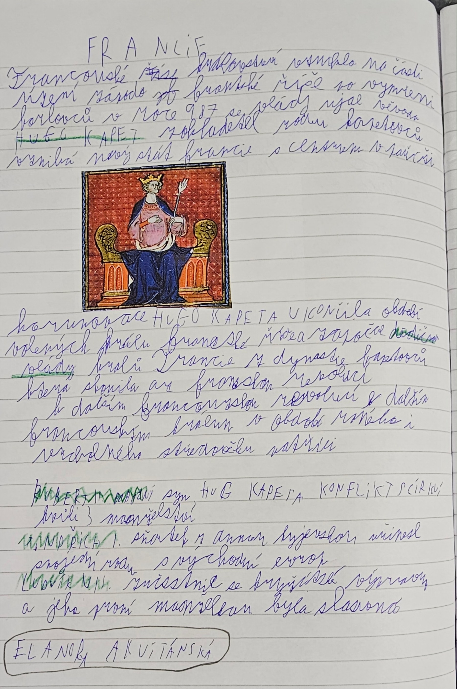

# Strana 15 – Francie

Čitelná rekonstrukce rukopisu, ne doslovný OCR výstup. Přeškrtnuté slovo („říše“) je vynecháno.

> **Francie**
>
> Francouzské království vzniklo na části území západofranské říše. Po vymření Karlovců v roce 987 se vlády ujal vévoda **Hugo Kapet**, zakladatel rodu Kapetovců. Vzniká nový stát Francie s centrem v Paříži.
>
> Korunovace Huga Kapeta ukončila období volených králů Franské říše a započala dědičné vlády králů Francie z dynastie Kapetovců, která skončila až francouzskou revolucí.
>
> K dalším francouzským králům v období raného i vrcholného středověku patřili:
>
> - **Robert II.** – syn Huga Kapeta, konflikt s církví kvůli 3 manželstvím
> - **Jindřich I.** – sňatek s Annou Kyjevskou, přinesl spojení rodu s východní Evropou
> - **Ludvík VII.** – účastnil se křížové výpravy a jeho první manželkou byla slavná **Eleanora Akvitánská** (zakroužkováno)

*Nalepený obrázek bez popisku: středověká miniatura krále na trůnu.*

Výklad a historické upřesnění: [Francie](../../ucivo/francie.md).
