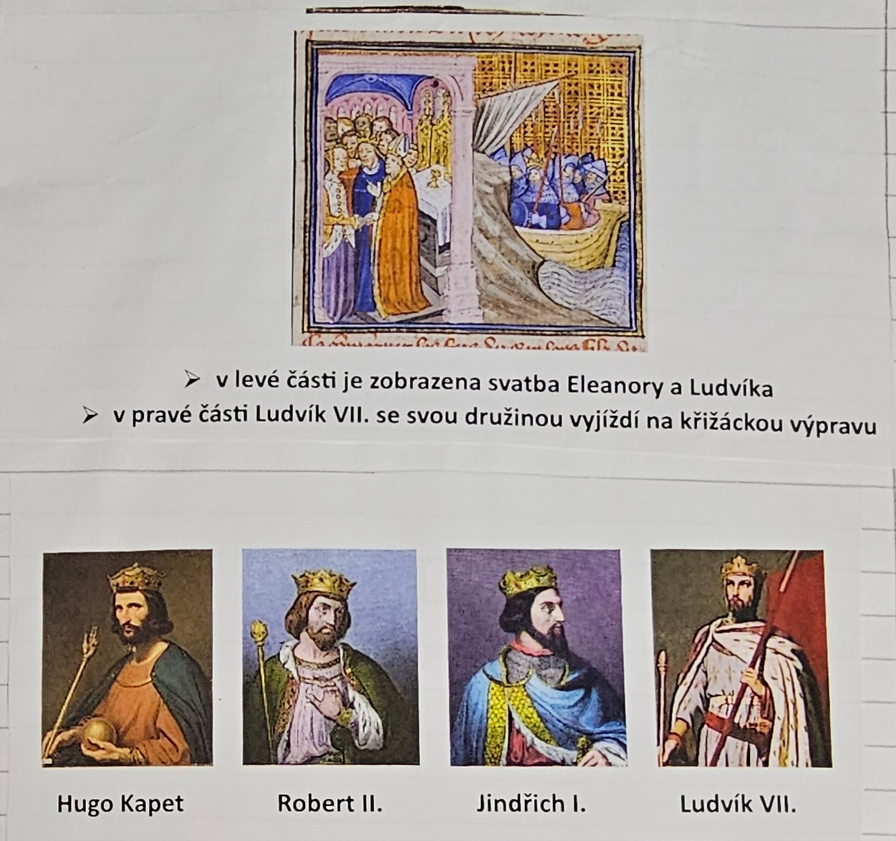

# Strana 16 – Francie, obrázky

Tištěné výstřižky, bez rukopisu.

Miniatura s popiskem:

> - v levé části je zobrazena svatba Eleanory a Ludvíka
> - v pravé části Ludvík VII. se svou družinou vyjíždí na křižáckou výpravu

*Portréty s popisky: Hugo Kapet; Robert II.; Jindřich I.; Ludvík VII.*

Výklad: [Francie](../../ucivo/francie.md).
