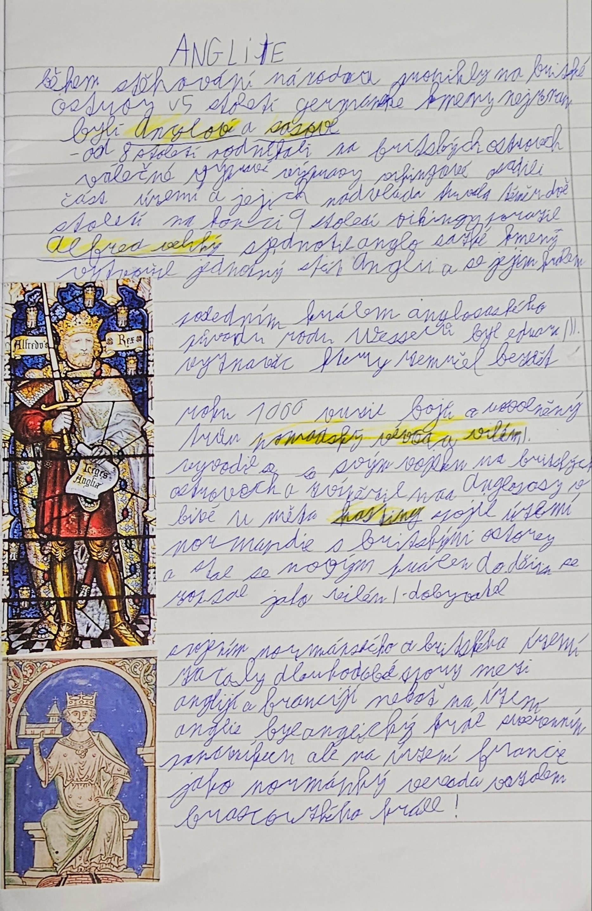

# Strana 17 – Anglie

Čitelná rekonstrukce rukopisu, ne doslovný OCR výstup.

> **Anglie**
>
> Během stěhování národů pronikly na Britské ostrovy v 5. století germánské kmeny, nejznámější byli **Anglové** a **Sasové**.
>
> - od 8. století podnikali na Britských ostrovech válečné výpravy Vikingové, osadili část území a jejich nadvláda trvala téměř dvě století. Na konci 9. století Vikingy porazil **Alfréd Veliký**, sjednotil anglosaské kmeny, vytvořil jednotný stát Anglii a stal se jejím králem.
>
> Posledním králem anglosaského původu z rodu Wessexů byl Eduard III. Vyznavač, který zemřel bez dětí.
>
> Roku 1066 vypukly boje o uvolněný trůn. **Normandský vévoda Vilém I.** vyrazil se svým vojskem na Britské ostrovy a zvítězil nad Anglosasy v bitvě u města **Hastings**, spojil území Normandie s Britskými ostrovy a stal se novým králem. Do dějin se zapsal jako Vilém I. Dobyvatel.
>
> Spojením normandského a britského území nastaly dlouhodobé spory mezi Anglií a Francií, neboť na území Anglie byl anglický král svrchovaným panovníkem, ale na území Francie jako normandský vévoda vazalem francouzského krále!

*Nalepené obrázky: vitráž s nápisem „Alfredus Rex“ (Alfréd Veliký); sedící král s modelem stavby (bez popisku, u textu o Vilémovi I.).*

Výklad a historické upřesnění: [Anglie](../../ucivo/anglie.md).
