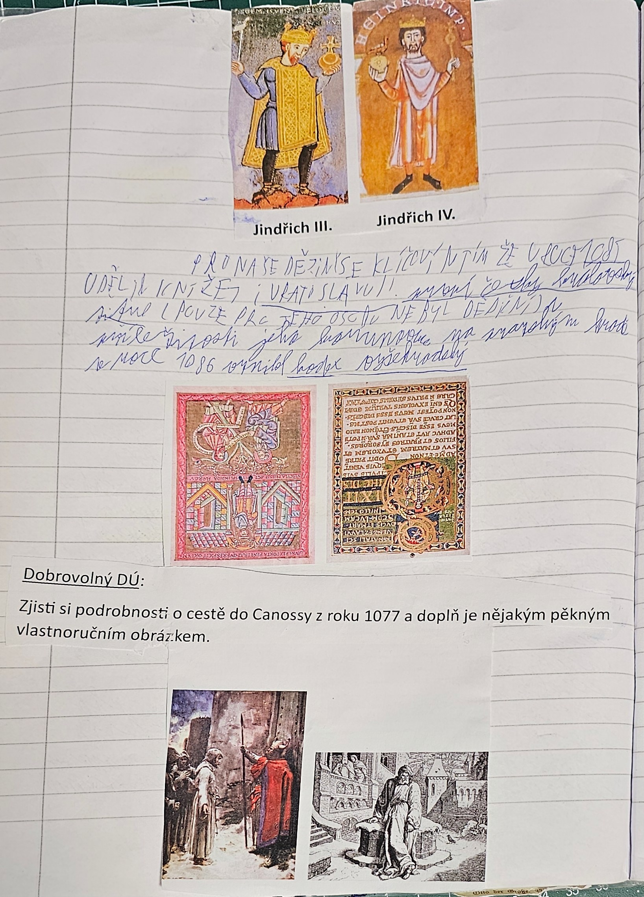

# Strana 18 – Svatá říše římská: Sálovci, Vratislav II., Canossa

Čitelná rekonstrukce rukopisu, ne doslovný OCR výstup. Podtržené pasáže jsou **tučně**. Navazuje na stranu 6.

*Obrázky s tištěnými popisky: Jindřich III.; Jindřich IV.*

> Pro naše dějiny je klíčový fakt, že v roce **1085** udělil knížeti **Vratislavovi II.** **první český královský titul** (pouze pro jeho osobu, nebyl dědičný). U příležitosti jeho korunovace na Pražském hradě v roce 1086 vznikl **Kodex vyšehradský**.

*Dvě nalepené stránky z Kodexu vyšehradského (vzhůru nohama), bez popisku.*

Tištěný lístek:

> **Dobrovolný DÚ:** Zjisti si podrobnosti o cestě do Canossy z roku 1077 a doplň je nějakým pěkným vlastnoručním obrázkem.

*Dva nalepené obrázky ke Canosse, bez popisku.*

Výklad: [Svatá říše římská](../../ucivo/svata-rise-rimska.md).
